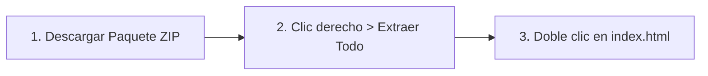

# 📘 Master Business Dashboard — Manual Oficial de Usuario (v1.6.1)
**Sistema de Control Financiero Ejecutivo para Pequeñas Empresas y Contratistas de New Jersey**  
*Versión Oficial: 1.6.1*  
*Autor e Ingeniero Principal: [Victor Montoya Rojas](https://www.linkedin.com/in/victormontoyarojas/) | Soporte Directo: `andres00787@gmail.com`*

---

> ### 🌐 Looking for English? / ¿Prefiere leer en Inglés?
> To consult the full official manual in English, open the dedicated file: **[USER_GUIDE_EN.md](file:///c:/Users/Andr%C3%A9s%20Montoya/.gemini/antigravity-ide/scratch/nj-business-budget-v1/USER_GUIDE_EN.md)**.

---

## 🎯 Propósito de este Manual
Este manual proporciona a contratistas, pequeñas empresas, profesionales de oficios y firmas de servicios en Nueva Jersey una guía completa, directa y operativa para dominar el **Master Business Dashboard (v1.6.1)** sin enredos técnicos ni dolores de cabeza contables.

Al seguir esta guía aprenderás a:
1. **Administrar Contratos, Anticipos y Facturación Progresiva**: Controlar cuentas de usuarios, depósitos iniciales, pagos progresivos y saldos pendientes, con la nueva opción de estado `"Accepted"` para contratos o propuestas aprobadas.
2. **Calcular el Costeo Universal de Obra por Proyectos (Job Costing)**: Vincular tus contratos y facturas con los gastos de las 6 disciplinas (materiales y compras directas, nómina y subcontratistas 1099, peajes E-ZPass y gasolina, patios de acopio y almacén de obra, fianzas de cumplimiento y pólizas de seguro de proyecto, y servicios de obra como luz provisional y contenedores de escombros) que compartan el mismo **PROJECT** para calcular la rentabilidad neta real ($) y el margen (%) al instante.
3. **Dominar el Balance General Ejecutivo (Estándar Harvard Business School)**: Controlar tus Activos, Pasivos y Patrimonio bajo la ecuación $\text{Activos} = \text{Pasivos} + \text{Patrimonio}$, supervisar tu capital de trabajo, ratio circulante ($\ge 1.5x$) y generar estados formales para bancos.
4. **Monitorear Indicadores con Precisión de Exchange de Trading**: Visualizar tus signos vitales financieros en cuadros compactos tipo terminal bursátil que eliminan números y textos sueltos o desordenados.
5. **Utilizar Pestañas de Navegación Dinámicas**: Habilitar únicamente los módulos que tu negocio realmente utiliza; las pestañas inactivas desaparecen inmediatamente de la barra superior para mantener tu espacio de trabajo enfocado y limpio.
6. **Aplicar la Exención de Mejora de Capital de NJ (Formulario ST-8 al 0% de Sales Tax)**: Eximir legalmente del 6.625% de impuesto sobre ventas las obras de construcción y remodelación permanente bajo la ley N.J.S.A. 54:32B-3 con total respaldo ante auditorías.
7. **Activar el Centinela de Seguros de Subcontratistas 1099**: Detectar subcontratistas sin seguro vigente (COI) en color rojo antes de que la auditoría anual de Workers' Comp de Nueva Jersey te aplique multas y recargos patronales.
8. **Generar Facturas y Presupuestos Imprimibles en 1 Clic**: Producir documentos PDF profesionales con formato formal listos para entregar al usuario o imprimir.
9. **Trabajar en Microsoft Excel Tradicional**: Utilizar el libro complementario `NJ_Small_Business_Budget_v1.6.1.xls` con protección de fórmulas, celdas celestes de entrada y una hoja dedicada exclusiva de **Project Job Costing** que consolida el análisis de cada proyecto.
10. **Consultar Guías Operativas y Ejemplos Visuales en Cada Pestaña**: Acceder mediante el botón interactivo **"📖 Guía de Pestaña"** en cada módulo a instrucciones paso a paso, representaciones visuales idénticas a la aplicación, requisitos obligatorios del IRS y New Jersey, y consejos pro de auditoría contable.

---

## 📦 Qué Hacer con los Archivos al Recibirlos por Correo o Enlace
Cuando descargues el paquete oficial (`SBBT_v1.6.1_Ready_To_Use.zip`), sigue estos 3 sencillos pasos:

1. **Descomprimir la Carpeta ZIP**: Haz clic derecho sobre `SBBT_v1.6.1_Ready_To_Use.zip` y selecciona **"Extraer todo..."** (o *Extract All*). Elige cualquier carpeta de tu preferencia (Escritorio o Documentos).
2. **Abrir el Tablero Web**: Haz doble clic en el archivo **`index.html`**. Se abrirá de inmediato en Google Chrome, Microsoft Edge, Safari, Brave o Mozilla Firefox.
3. **Libro Opcional de Microsoft Excel**: Si prefieres trabajar dentro de Microsoft Excel, abre **`NJ_Small_Business_Budget_v1.6.1.xls`**. Las fórmulas de cálculo están bloqueadas contra sobrescritura accidental; las celdas celestes están listas para tus números.

> [!IMPORTANT]
> **Cero Instalación y Privacidad Total**: No necesitas servidores, bases de datos ni conexión a internet. La aplicación corre 100% dentro de tu navegador de manera privada y segura. Tus números financieros confidenciales jamás salen de tu computadora.

---

## ⚡ Guía de Inicio Rápido en 3 Pasos (Resultados en 60 Segundos)

Si no dispones de tiempo para leer todo el documento, realiza estos 3 pasos ahora mismo:

1. **Paso 1 — Selecciona tu Mes y Año Activo**: En el encabezado superior, elige tu mes de trabajo (ej. **October**) y año fiscal (**2025**). Todas las tablas y gráficos se sincronizarán con este período.
2. **Paso 2 — Registra un Contrato o Factura**:
   * Ve a la pestaña **💵 Invoicing & Sales**.
   * Haz clic en **➕ Add Invoice / Contract**.
   * Escribe el nombre de usuario, nombre de proyecto, fecha mediante los menús desplegables, valor del contrato y anticipo recibido.
   * Selecciona el estado correspondiente:
     * `"Accepted"` si la propuesta fue aprobada por el usuario y la orden de trabajo está confirmada.
     * `"Deposit / Active"` si ya cobraste el anticipo inicial y la obra está en ejecución.
     * `"Quote / Sent"` si es un presupuesto enviado pendiente de confirmación.
     * `"Paid in Full"` cuando el usuario haya liquidado el saldo total del trabajo.
3. **Paso 3 — Consulta tu Rentabilidad por Proyecto y Tablero de Control**: Ve a la pestaña **📈 Dashboard**. Revisa la tabla de **Job Costing & Project Profitability** para comprobar el margen de beneficio de cada obra, y consulta los cuadros tipo exchange con el dinero en banco, cuentas por cobrar y reservas fiscales.

---

## 📑 Tabla de Contenidos Navegable
1. [Prerrequisitos y Compatibilidad del Sistema](#1-prerrequisitos-y-compatibilidad-del-sistema)
2. [Convenciones Contables y Código Visual de Celdas](#2-convenciones-contables-y-código-visual-de-celdas)
3. [Guía Funcional Paso a Paso](#3-guía-funcional-paso-a-paso)
   * [3.1 Encabezado, Período Fiscal y Gestor Dinámico de Módulos](#31-encabezado-período-fiscal-y-gestor-dinámico-de-módulos)
   * [3.2 Pestaña 1: Dashboard Ejecutivo (Cuadros Tipo Exchange y Rentabilidad de Obra)](#32-pestaña-1-dashboard-ejecutivo-cuadros-tipo-exchange-y-rentabilidad-de-obra)
   * [3.3 Pestaña 2: Facturación y Ventas, Estado "Accepted" y Facturas PDF (NJ ST-8)](#33-pestaña-2-facturación-y-ventas-estado-accepted-y-facturas-pdf-nj-st-8)
   * [3.4 Pestaña 3: Costos Directos (COGS) y Facturas de Materiales](#34-pestaña-3-costos-directos-cogs-y-facturas-de-materiales)
   * [3.5 Pestañas 4 a 8: Gastos Operativos y Centinela de Seguros 1099](#35-pestañas-4-a-8-gastos-operativos-y-centinela-de-seguros-1099)
   * [3.6 Pestaña 9: Impuestos de NJ y Reservas Safe Harbor (ST-50 y CBT)](#36-pestaña-9-impuestos-de-nj-y-reservas-safe-harbor-st-50-y-cbt)
   * [3.7 Pestaña 10: Estado de Pérdidas y Ganancias (P&L 12 Meses)](#37-pestaña-10-estado-de-pérdidas-y-ganancias-pl-12-meses)
   * [3.8 Pestaña 11: Simulador Sandbox No Destructivo](#38-pestaña-11-simulador-sandbox-no-destructivo)
   * [3.9 Centro de Herramientas del Sistema (Importador de Excel, Exportación Protegida y Respaldos)](#39-centro-de-herramientas-del-sistema-importador-de-excel-exportación-protegida-y-respaldos)
4. [Solución de Problemas (Causa y Efecto)](#4-solución-de-problemas-causa-y-efecto)
5. [Glosario y Anexo Legal de Nueva Jersey](#5-glosario-y-anexo-legal-de-nueva-jersey)

---

## 1. Prerrequisitos y Compatibilidad del Sistema
* **Navegador Web**: Cualquier navegador moderno (Google Chrome, Microsoft Edge, Mozilla Firefox, Apple Safari o Brave).
* **Sistema Operativo**: Windows 10/11, macOS, Linux, iPadOS o ChromeOS.
* **Resolución de Pantalla**: Optimizado para pantallas de laptop y escritorio (1280×720 o superior).
* *(Opcional)* **Software de Hoja de Cálculo**: Microsoft Excel 2016+, Office 365 o LibreOffice Calc si deseas abrir directamente los archivos `.xls` o `.xlsx`.

---

## 2. Convenciones Contables y Código Visual de Celdas
Para prevenir errores contables y brindar claridad visual inmediata, las celdas se rigen por un código visual estricto:

| Apariencia Visual | Significado | Cómo Interactuar |
|---|---|---|
| 🔵 **Azul Celeste Suave (`#E0F2FE`)** | **Dato Editable por el Usuario** | Haz clic o doble clic para editar. Presiona `Enter` o haz clic afuera para guardar. |
| ⚪ **Blanco/Pizarra Bloqueado (`#F8FAFC`)** | **Fórmula y Cálculo Automático** | **Protegido y Bloqueado**. Se recalcula automáticamente en tiempo real al ingresar datos. |
| 🟢 **Insignia Verde Suave** | **Margen Saludable / Pagado** | Facturas cobradas, margen de proyecto > 35%, o reservas fiscales al día. |
| 🟡 **Insignia Ámbar Suave** | **Margen Moderado / Pendiente** | Facturas con saldo pendiente o margen de proyecto entre 15% y 35%. |
| 🔴 **Insignia Roja Suave** | **Vencido / Riesgo de Auditoría** | Facturas vencidas en mora, margen < 15%, o subcontratista 1099 sin seguro (COI). |

---

## 3. Guía Funcional Paso a Paso

### 3.1 Encabezado, Período Fiscal y Gestor Dinámico de Módulos
* **Selector de Período Fiscal**: Elige el Mes y Año en la barra superior. Al seleccionar `October 2025`, todas las métricas, rentabilidades y tablas se sincronizan a ese mes. Puedes seleccionar `All Months (YTD)` para ver el año completo o `Trailing 12 Months (T12M)` para un análisis móvil de los últimos 12 meses.
* **Gestor Dinámico de Módulos (`⚙️ Modules`)**: Presiona el botón **"⚙️ Modules"** en la barra superior o en System Tools. Marca únicamente las categorías que tu empresa opera (por ejemplo, desmarca Flota si no utilizas vehículos comerciales, o Instalaciones si trabajas desde casa). Las pestañas desactivadas desaparecen de inmediato de la barra de navegación para que solo veas lo que estás utilizando.
* **Cuadro de Bienvenida con Dimensiones Fijas**: Al abrir la herramienta, un modal de bienvenida interactivo te recibe con un tamaño exacto y estable que no cambia de tamaño entre pasos. Al presionar **"💡 How to Start"**, el cuadro de bienvenida se cierra suavemente antes de abrir la guía de inicio, evitando ventanas encimadas o sobrepuestas.

### 3.2 Pestaña 1: Dashboard Ejecutivo (Cuadros Tipo Exchange y Rentabilidad de Obra)
* **Cuadros Métricos de Precisión Tipo Exchange de Trading**: En el Modo Avanzado, los indicadores se organizan en cajas compactas y estructuradas inspiradas en terminales financieras:
  * **AR Aging & Collection Health**: Presenta el Total Facturado, Cuentas por Cobrar Activas y Saldos Vencidos en cuadros laterales con números en tipografía monospace.
  * **Category Spending & OpEx Distribution**: Muestra los Costos Directos de Obra (COGS), Gastos Fijos Operativos (OpEx) y Porcentaje de Asignación en cuadros ordenados.
  * **Cash Runway & Operating Liquidity**: Expone las Reservas Líquidas en Banco, Consumo Mensual (Burn Rate) y Margen de Capital de Trabajo.
  * **NJ Safe Harbor Tax Sentinel**: Detalla los Fondos Reservados, Estimado por Pagar y la Brecha o Faltante Fiscal.
* **Tarjeta de Rentabilidad por Proyecto (Job Costing)**: Vincula automáticamente tus ingresos con las compras de materiales y subcontratistas que comparten el mismo **Nombre de Proyecto (PROJECT)**. Muestra el Contrato Facturado, Cobrado, Costos Directos, Margen Neto ($), Margen (%) y estado de salud financiera.
* **Banner de Alerta de Cobranzas Vencidas**: Aparece automáticamente informando el monto exacto en mora cuando existen facturas vencidas con saldo pendiente.

### 3.3 Pestaña 2: Facturación y Ventas, Estado "Accepted" y Facturas PDF (NJ ST-8)
* **Nueva Opción de Estado "Accepted"**: El menú desplegable de estados incluye la opción `"Accepted"` para aquellos presupuestos o contratos que han sido aprobados por el usuario y están confirmados antes de iniciar obra o recibir el depósito.
  * Opciones disponibles: `"Paid in Full"`, `"Deposit / Active"`, `"Pending Balance"`, `"Accepted"`, `"Quote / Sent"`, `"Overdue"`.
* **Campo Opcional de Nombre de Proyecto (PROJECT)**: Permite etiquetar cada factura con el nombre de la obra (ej. `Renovación Casa Morristown`) para vincularla automáticamente con los gastos de materiales.
* **Exención de Mejora de Capital (NJ Form ST-8 al 0%)**: Bajo la ley N.J.S.A. 54:32B-3, los trabajos de construcción permanente o remodelación en Nueva Jersey están exentos del 6.625% de impuesto sobre ventas si se cuenta con el Formulario ST-8 firmado. Elige `"ST-8 (0% - NJ Capital Improvement)"` en la columna de impuestos para facturar al 0% con total respaldo legal.
* **Generador de Facturas y Presupuestos en PDF (`🖨️ PDF`)**: Al hacer clic en el botón `🖨️ PDF`, se abre una factura formal. Para trabajos con estado `"Accepted"`, el encabezado muestra **"ACCEPTED WORK ORDER & CONTRACT"**; para presupuestos, **"CONTRACT ESTIMATE & PROPOSAL"**; y para facturas regulares, **"INVOICE / BILL OF WORK"**.

### 3.4 Pestaña 3: Costos Directos (COGS) y Facturas de Materiales
* Registra compras de materiales, madera, cables, suministros, alquiler de contenedores (dumpsters) y facturas de subcontratistas directos.
* Ingresa el **Nombre del Proyecto (PROJECT)** con autocompletado inteligente para que alimente de inmediato la tabla de **Job Costing** en el Dashboard.

### 3.5 Pestañas 4 a 8: Gastos Operativos y Centinela de Seguros 1099
* **Flota y Vehículos (Tarifa IRS $0.70/milla)**: Permite elegir entre registro de gastos reales de combustible o deducción estándar por millaje del IRS.
* **Instalaciones, Taller y Alquiler**: Control de renta comercial, yarda de almacenamiento, cuotas de mantenimiento (CAM) o hipoteca comercial.
* **Pólizas de Seguros**: Pólizas obligatorias de Workers' Comp de NJ, Responsabilidad Civil General (CGL) y seguro de herramientas con amortización mensual automática.
* **Nómina y Centinela de Subcontratistas 1099**:
  * Empleados W-2 con cálculo automático del 10.9% de impuestos patronales (FICA, NJ SUI y FLI).
  * **Centinela de Auditoría 1099**: Para contratistas independientes 1099, registra `COI Verified` o `NO COI (Audit Risk ⚠️)`. Los subcontratistas sin seguro vigente se destacan en color rojo para protegerte de recargos severos en la auditoría anual de pólizas de NJ.
* **Servicios Públicos y Software**: Facturas de electricidad (PSE&G), gas, agua, telecomunicaciones y suscripciones de software.

### 3.6 Pestaña 9: Impuestos de NJ y Reservas Safe Harbor (ST-50 y CBT)
* Control de pagos trimestrales del impuesto sobre ventas **ST-50** y pagos estimados de impuestos corporativos **CBT**.
* Monitorea la **Brecha Fiscal (Safe Harbor Gap)**: Informa en verde si cumpliste las reservas obligatorias o en rojo si existe un faltante.

### 3.7 Pestaña 10: Estado de Pérdidas y Ganancias (P&L 12 Meses)
* Reporte consolidado a 12 meses con Ingresos Totales, Costo de Materiales (COGS), Ganancia Bruta, Gastos Operativos Totales y Ganancia Operativa Neta en Mano.

### 3.8 Pestaña 11: Simulador Sandbox No Destructivo
* Proyecta escenarios financieros moviendo controles deslizantes para simular aumentos de ingresos o reducción de costos. Los cálculos operan en un entorno seguro y nunca alteran tus datos contables reales.

### 3.9 Centro de Herramientas del Sistema (Importador de Excel, Exportación Protegida y Respaldos)
* **Motor de Importación de Excel**: Sube un archivo `.xls` o `.xlsx` modificado para actualizar tu sistema web.
* **Descargar Respaldo Local (`.json`)**: Guarda una copia de seguridad íntegra de toda tu información en tu disco duro.
* **Generar Hoja Oficial de Excel (`.xls`)**: Exporta tu libro de trabajo con protección nativa de fórmulas.
* **Limpiar a Plantilla en Blanco ($0.00)**: Deja todas las hojas en $0.00 listas para entregar al usuario final.

### 3.16 Balance General Ejecutivo y Centinela de Salud Financiera (Estándar Harvard Business School)
* **¿Qué es el Balance General?**: Siguiendo los principios de Harvard Business School Online, el Balance General (Estado de Situación Financiera) es el reporte contable formal que muestra lo que tu empresa tiene (**Activos**), lo que debe (**Pasivos**) y el valor neto de los socios (**Patrimonio**):
  $$\text{Activos} = \text{Pasivos} + \text{Patrimonio}$$
* **Sincronización Automática en Tiempo Real**: ¡No tienes que reescribir nada! SBBT extrae automáticamente:
  - **Efectivo Disponible**: Saldo real en banco calculado a partir de tus reservas iniciales más todos los cobros recibidos menos todos los pagos operativos y materiales efectuados.
  - **Cuentas por Cobrar (A/R)**: Saldos pendientes de cobro de facturas y contratos activos.
  - **Cuentas por Pagar (A/P)**: Órdenes de compra y facturas de subcontratistas en estado "Pending / Net 30" en COGS.
  - **Pasivo de Sales Tax de NJ**: Impuesto retenido de clientes pendiente de remitir a Trenton vía Formulario ST-50.
  - **Retiros de Dueño (Owner Draws)**: Distribuciones de capital registradas en Nómina.
  - **Utilidad Neta del Ejercicio**: Beneficio neto en caja sincronizado en vivo desde el P&L de 12 Meses.
* **4 Ratios Financieros Clave (Liquidez y Solvencia)**:
  - **Capital de Trabajo Neto** ($\text{Activo Circulante} - \text{Pasivo Circulante}$): Mide el colchón de liquidez operativa inmediata.
  - **Razón Circulante (Current Ratio)** ($\frac{\text{Activos Circulantes}}{\text{Pasivos Circulantes}}$): El estándar de Harvard exige $\ge 1.5x$ (las etiquetas tipo semáforo alertan si cae por debajo de $1.0x$).
  - **Prueba Ácida (Quick Ratio)** ($\frac{\text{Efectivo} + \text{A/R}}{\text{Pasivos Circulantes}}$): Mide tu capacidad de pago inmediato sin necesidad de vender materiales o inventarios.
  - **Razón Deuda/Patrimonio (Debt-to-Equity)** ($\frac{\text{Pasivo Total}}{\text{Patrimonio}}$): Mide el nivel de apalancamiento financiero frente al capital de los dueños (estándar $\le 1.5x$).
* **Equilibrio en 1 Clic (⚡ Auto-Reconciliar Patrimonio)**: Si tu balance presenta alguna diferencia, haz clic en **"⚡ Auto-Reconcile Owner Equity"**. El sistema calcula la variación y genera/ajusta automáticamente una reserva de patrimonio para que la ecuación $\text{Activos} = \text{Pasivos} + \text{Patrimonio}$ quede 100% balanceada.
* **🖨️ Generador de Estado Formal para Bancos y Fianzas**: Haz clic en **"🖨️ Print Formal Bank Statement"** para generar un documento formal membretado listo para imprimir o guardar en PDF, con tablas GAAP de doble columna, notas explicativas y líneas de firma para el Administrador y Contador (CPA).

### 3.17 Guías Operativas de Pestaña y Ejemplos Visuales Idénticos ("📖 Guía de Pestaña")
* **Acceso Directo e Intuitivo**: Cada cabecera de pestaña, barra de herramientas y tarjeta explicativa cuenta con un botón interactivo **"📖 Guía de Pestaña"**.
* **5 Capas de Claridad y Protección**:
  1. **🎯 ¿Para qué sirve esta pestaña?**: Propósito práctico en lenguaje directo para el dueño del negocio o contratista.
  2. **📋 Flujo Paso a Paso**: Instrucciones secuenciales numeradas para ingresar o auditar los datos sin complicaciones.
  3. **🖼️ Ejemplos Visuales Idénticos a la Aplicación**: Réplicas exactas de los componentes de la interfaz (celdas celestes `#E0F2FE` de entrada, celdas de fórmulas protegidas, etiquetas de estado y notas de advertencia).
  4. **🏛️ Requisitos Obligatorios del IRS y Ley de New Jersey**: Reglas legales estrictas (exención ST-8, validación de seguro COI de subcontratistas, bitácora de millas y peajes bajo IRC §274(d), y reservas CBT de Trenton).
  5. **💡 Consejo Pro del Auditor**: Recomendaciones de expertos para evitar multas, superar auditorías y blindar financieramente la compañía.
* **Barra de Navegación Horizontal en la Ventana**: Permite explorar las guías de cualquiera de los 13 módulos sin necesidad de cerrar y abrir la ventana.

### 3.18 Interfaz de Doble Skin: Menú Lateral Magnific AI Pro vs. Pestañas Clásicas
* **Transformación Instantánea en 1 Clic**: Haz clic en el botón **"✨ Skin: Magnific Dashboard"** (en la cabecera, al pie del menú lateral o en *System Tools*) para alternar en cualquier momento entre:
  - **Modo Clásico**: Pestañas horizontales en la parte superior, ideal para usuarios tradicionales de hojas de cálculo.
  - **Modo Magnific AI Pro**: Interfaz moderna estilo SaaS con menú lateral izquierdo colapsable, secciones agrupadas (*Command Center*, *Operaciones y Facturas*, *Logística e Instalaciones*, *Inteligencia Financiera*, *Ajustes y Herramientas*), migas de pan dinámicas y mayor amplitud visual para tablas de datos.
* **Seguridad de Datos y Almacenamiento Persistente**: La herramienta solicita al navegador activar el almacenamiento persistente (`navigator.storage.persist()`), evitando que el navegador borre automáticamente la base de datos local por falta de espacio en disco.

---

## 4. Solución de Problemas (Causa y Efecto)

| Problema Observado | Causa Raíz | Solución |
|---|---|---|
| Agrego una factura y no se ve en la tabla | El filtro de mes está configurado en otro período | Revisa el menú superior. La aplicación auto-sincroniza al mes de la factura, pero si cambiaste de mes manualmente, selecciona `All Months (YTD)` o el mes correspondiente. |
| El gráfico de ingresos marca $0 aunque tengo facturas | Las facturas tienen estado `"Pending"` o `"Quote / Sent"` | El gráfico mide **dinero real en caja**. Cambia el estado a `"Deposit / Active"` o `"Paid in Full"` cuando el usuario realice el pago. |
| La tabla de Job Costing dice que no hay proyectos asignados | Las facturas y materiales no tienen nombre de proyecto | Asigna el mismo Nombre de Proyecto (ej. `Renovación Casa Morristown`) en las facturas y en la pestaña de COGS. |
| Una fila de nómina muestra `⚠️ NO COI (Audit Risk)` | El subcontratista 1099 no tiene certificado de seguro | Solicita a tu subcontratista su Certificado de Seguro (COI) vigente con tu empresa como titular y cambia su estado a `COI Verified`. |
| No puedo editar una celda de fórmula en el archivo Excel | La protección nativa de fórmulas está activa | Las celdas de fórmulas (`#F8FAFC`) están protegidas para evitar errores contables. Ingresa tus números en las celdas celestes (`#E0F2FE`). |
| Una pestaña no aparece en la barra superior | El módulo fue desactivado en el Asistente de Módulos | Haz clic en `⚙️ Modules` en la barra superior o en System Tools y marca el módulo para reactivar su pestaña de inmediato. |

---

## 5. Glosario y Anexo Legal de Nueva Jersey
* **Job Costing (Costeo por Proyecto)**: Método contable que vincula materiales, mano de obra y subcontratistas a un contrato específico para conocer la rentabilidad neta real de cada obra.
* **NJ Form ST-8 (Certificado de Mejora de Capital)**: Documento oficial de la División de Tributación de Nueva Jersey que certifica que el trabajo realizado constituye una mejora permanente al inmueble, eximiendo el contrato del 6.625% de Sales Tax.
* **COI (Certificado de Seguro)**: Documento estándar ACORD que prueba que un subcontratista cuenta con su propia póliza activa de Responsabilidad Civil y Workers' Compensation.
* **NJ HICPA (Registro de Contratistas de Obras Residenciales)**: La normativa N.J.A.C. 13:45A-16 exige que todo contratista de mejoras del hogar esté registrado ante la División de Asuntos del Consumidor de NJ.
* **Safe Harbor**: Mantenimiento de fondos suficientes para pagos trimestrales estimados que evitan penalidades por pago insuficiente ante el Estado de NJ.
