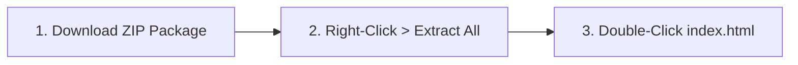

# 📖 Master Business Dashboard — Official User Guides Portal
# 📘 Portal Oficial de Manuales de Usuario (v1.4.1)

**Executive Financial Control System for New Jersey Local Businesses & Trade Contractors**  
*Official Release: Version 1.4.1*  
*Author & Lead Engineer: [Victor Montoya Rojas](https://www.linkedin.com/in/victormontoyarojas/) | Support: `andres00787@gmail.com`*

---

## 🌐 Choose Your Language / Seleccione su Idioma

To deliver a clear, distraction-free reading experience, the complete operational documentation has been divided into **two separate, dedicated manuals**:

### 🇺🇸 [ENGLISH USER MANUAL (USER_GUIDE_EN.md)](USER_GUIDE_EN.md)
*Click above to open the 100% complete English manual with step-by-step guides, New Jersey tax statutes (ST-8, CBT), Job Costing, and troubleshooting.*

---

### 🇪🇸 [MANUAL OFICIAL EN ESPAÑOL (MANUAL_DE_USUARIO_ES.md)](MANUAL_DE_USUARIO_ES.md)
*Haz clic arriba para abrir el manual completo 100% en español con instrucciones paso a paso para contratistas y negocios en New Jersey, exenciones ST-8, costeo de obra y resolución de dudas.*

---

## 📦 What to Do With Your Files / Qué Hacer con los Archivos

1. **Extract the ZIP Package**: Right-click `SBBT_v1.4.1_Ready_To_Use.zip` and select **"Extract All..."**.
2. **Launch the Master Web Dashboard**: Double-click **`index.html`** in any web browser.
3. **Optional Native Excel Companion**: Double-click **`NJ_Small_Business_Budget_v1.4.1.xls`** to work directly in Microsoft Excel with built-in formula protection.

---

## ⚡ Quick Links / Enlaces Rápidos
* 🇺🇸 **[Full English User Guide](USER_GUIDE_EN.md)**
* 🇪🇸 **[Manual Completo en Español](MANUAL_DE_USUARIO_ES.md)**
* 🚀 **[Release Notes (v1.4.1)](RELEASE_NOTES.md)**
* 📑 **[Project Overview (README.md)](README.md)**
