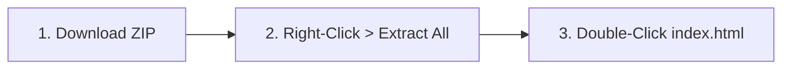
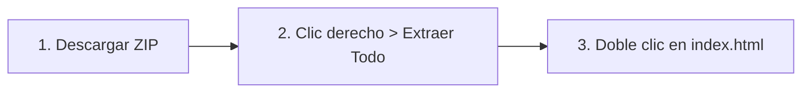

# 📖 START HERE: Official User Manual & Quick-Start Guide
# 📘 EMPIEZA AQUÍ: Manual Oficial de Usuario y Guía de Inicio Rápido
**Master Business Dashboard (Executive Financial Control System) — Version 1.2.4 BETA**  
*Author & Engineer: Victor Montoya Rojas ([@goanarchy](https://www.linkedin.com/in/victormontoyarojas/)) | Direct Support: `andres00787@gmail.com`*

---

> ### 🌐 Language Selector / Selector de Idioma
> * 🇺🇸 **[Read in English (Click Here)](#-english-user-manual)**
> * 🇪🇸 **[Leer en Español (Haz Clic Aquí)](#-manual-de-usuario-en-español)**

---

# 🇺🇸 Master Business Dashboard — User Manual (v1.2.4 BETA)

## 🎯 Purpose of this Manual
This manual gives you a straightforward, step-by-step roadmap to master the **Master Business Dashboard (v1.2.4 BETA)** without financial guesswork or technical frustration. By following this guide, you will be able to:
1. Track client quotes, sent estimates, and actual cash collected.
2. Record and classify direct project costs, materials, payroll, fleet, and overhead.
3. Automatically safeguard statutory New Jersey tax obligations (Sales Tax 6.625% and Corporate Business Tax CBT reserves).
4. Export clean, CPA-ready Microsoft Excel workbooks (`.xlsx` / `.xls`) with live formulas in a single click.

---

## 📦 What to Do With Your Files Upon Download or Email
When you receive your package (`SBBT_v1.2.4_BETA_Ready_To_Use.zip`) via email, direct link, or Google Drive, follow these 3 setup steps:

1. **Extract the ZIP Folder**: Right-click `SBBT_v1.2.4_BETA_Ready_To_Use.zip` and select **"Extract All..."** (or *Descomprimir*). Choose any folder on your computer (e.g., Desktop or Documents).
2. **Launch the Web Dashboard**: Double-click **`index.html`**. It opens immediately in Google Chrome, Microsoft Edge, Safari, or Mozilla Firefox.
3. **Optional Native Excel**: If you prefer Microsoft Excel, double-click **`NJ_Small_Business_Budget_v1.2.4.xls`**.

> [!IMPORTANT]
> **Zero Installation & 100% Data Privacy**: You do **not** need a web server, database, or internet connection. All calculations run locally in your browser. Your confidential business numbers never leave your computer.

---

## ⚡ 3-Step Quick Start (Achieve Results in 60 Seconds)

If you don't have time to read the entire guide, do these 3 steps right now:

1. **Step 1 — Set Your Month & Year**: At the top header, pick your active month (e.g., **October**) and fiscal year (**2025**). All tables and charts synchronize to this timeframe.
2. **Step 2 — Record a Quote or Paid Invoice**: Click the **💵 Invoicing & Sales** tab. Click **➕ Add Record**. Enter the client name, select the date via dropdown, enter the amount, and choose status:
   * Select `"Quote / Sent"` if it is a proposal sent to a prospect.
   * Select `"Paid / Closed"` if cash is already in your bank account.
3. **Step 3 — Inspect Your Real Cash Position**: Click the **📈 Dashboard** tab. Review your **Net Profit in Hand** and your **Inflow vs Outflow** 2-column comparative bar chart. When finished, click **📊 Excel Export** to save an Excel file for your records.

---

## 📑 Table of Contents
1. [Prerequisites: What You Need Before Starting](#en-prerequisites)
2. [Accounting & Color Conventions](#en-conventions)
3. [Step-by-Step Functional Guide](#en-steps)
   * [3.1 Header Controls & Global Fiscal Period](#en-header)
   * [3.2 Tab 1: Executive Dashboard (Basic vs Advanced Mode)](#en-tab1)
   * [3.3 Tab 2: Revenue, Quotes & Client Invoicing](#en-tab2)
   * [3.4 Tab 3: Project COGS & Material Expense Bills](#en-tab3)
   * [3.5 Tabs 4 to 8: Operating Expenses (OpEx)](#en-tab4-8)
   * [3.6 Tab 9: NJ Taxes & Safe Harbor Reserves](#en-tab9)
   * [3.7 Tab 10: 12-Month P&L Rollup](#en-tab10)
   * [3.8 System Tools Hub (Backups, Excel Export & Printing)](#en-tools)
4. [Troubleshooting Guide (Cause & Effect)](#en-troubleshooting)
5. [Glossary & New Jersey Statutory Annex](#en-glossary)

---

## 1. Prerequisites: What You Need Before Starting
* **Any Modern Web Browser**: Google Chrome, Microsoft Edge, Safari, Brave, or Firefox.
* **Display Resolution**: Optimized for desktop/laptop screens (1280x720 or higher).
* *(Optional)* **Microsoft Excel or LibreOffice**: Only needed if you wish to inspect the companion `.xls` spreadsheet or open exported workbooks.

---

## 2. Accounting & Visual Cell Conventions
To prevent formula corruption and provide immediate visual clarity, cells follow strict visual rules:

| Visual Appearance | Meaning | How to Interact |
|---|---|---|
| 🔵 **Soft Light Blue (`#E0F2FE`)** | **Fillable User Input** | Click or double-click to edit. Press `Enter` or click outside to save. |
| ⚪ **Locked White/Slate (`#F8FAFC`)** | **Formula & Auto-Calculated** | **Locked**. Recomputes automatically in real time whenever an input changes. |
| 🟢 **Soft Green Badge** | **Healthy Margin / Paid** | Indicates collected invoices, active insurance, or compliant tax reserves. |
| 🔴 **Soft Red Badge** | **Overdue / Budget Alert** | Indicates unpaid past-due invoices, expense leaks, or reserve deficits. |

---

## 3. Step-by-Step Functional Guide

### 3.1 Header Controls & Global Fiscal Period
* **Select Global Month & Year**: Click the dropdowns in the top header. Changing to `November 2025` instantly updates all dashboard metrics, variance calculations, and category tables.
* **Toggle Night Mode (🌙 Night / ☀️ Day)**: Click the moon/sun button to switch between daylight mode and a high-contrast dark theme.
* **💡 How to Start Button**: Click the golden lightbulb button at any time to open the quick 4-step onboarding roadmap.

### 3.2 Tab 1: Executive Dashboard (Basic vs Advanced Mode)
1. **View Core KPIs**: Inspect the top cards: **Gross Revenue**, **Total Expenses**, **Net Operating Income (NOI)**, **Cash Runway (Months)**, **NJ Tax Reserve Sentinel**, and **Accounts Receivable (AR)**.
2. **Switch Between Basic and Advanced Details**:
   * Click **"Basic Summary"** to view only the essential 2-column Inflow vs Outflow cash flow comparison and primary cash totals.
   * Click **"Advanced Details"** to display category variance breakdowns, expense allocations, and deep drill-down analytics.
3. **Compare Inflow vs Outflow**: The central 2-column chart compares total money collected vs total money spent. Toggle between **"Monthly"** (displays the last 3 rolling months side-by-side) and **"Annual"** (consolidated 12-month totals).

### 3.3 Tab 2: Revenue, Quotes & Client Invoicing
1. **Add a Client Record**: Click **➕ Add Record** at the top right of the table.
2. **Select Date via Dropdowns**: Choose the Month, Day, and Year. Days dynamically calculate based on the month (e.g., February caps at 28 or 29 days).
3. **Type Client / Job Name**: As you type, the system's smart memory displays Google-style suggestions of previous clients.
4. **Choose Status**:
   * `"Quote / Sent"`: Use this for proposals delivered to clients. Counts toward projected sales volume without artificially inflating bank cash.
   * `"Paid / Closed"`: Marks the invoice as collected. Adds money directly to **Cash In (Collected)**.
   * `"Pending"` or `"Overdue"`: Tracks outstanding Accounts Receivable.
5. **NJ Taxable Setting**:
   * Select **"Yes (6.625%)"** for taxable sales. The system isolates sales tax from net revenue.
   * Select **"No (Exempt)"** for exempt professional services.
   * Select **"Other %"** to specify a custom rate.

### 3.4 Tab 3: Project COGS & Material Expense Bills
1. **Navigate to 📦 Project COGS**: This area tracks direct job expenses (raw materials, subcontractor bills, equipment rental, and freight).
2. **Add a Vendor Bill**: Click **➕ Add Record**, select the date from dropdowns, type the vendor name, enter the bill amount, and assign it to a specific project.
3. **Audit Gross Margin**: The system immediately recalculates **Gross Profit = Gross Revenue - Direct COGS**.

### 3.5 Tabs 4 to 8: Operating Expenses (OpEx)
* **Tab 4: 🚗 Fleet & Mileage**: Choose between direct fuel receipts or the IRS standard business mileage deduction (**$0.70/mile for 2025**). Includes dedicated tracking for NJ Turnpike and Garden State Parkway tolls.
* **Tab 5: 🏢 Facility & Rent**: Log commercial lease payments, mortgage interest, property tax escrow, and CAM maintenance.
* **Tab 6: 🛡️ Insurance Policies**: Track mandatory NJ Workers' Compensation, General Liability, Commercial Auto, and Cyber coverage with monthly amortization schedules.
* **Tab 7: 👥 Payroll & Team**: Record W-2 employee wages, 1099-NEC contractor payments, and Owner Draws. Auto-calculates employer payroll tax burden (**~10.9%**).
* **Tab 8: ⚡ Utilities & Overhead**: Enter recurring electric (PSE&G), water, fiber internet, and SaaS subscriptions (QuickBooks, Google Workspace).

> [!TIP]
> **Modular ON/OFF Switches**: Don't have a commercial warehouse or vehicle fleet? Toggle the switch at the top right of any tab to **OFF**. That entire category will be cleanly bypassed from calculations without breaking totals.

### 3.6 Tab 9: NJ Taxes & Safe Harbor Reserves
1. **Monitor Quarterly Deadlines**: Displays statutory estimated tax due dates for NJ Corporation Business Tax (CBT-100ES) and quarterly Sales Tax (Form ST-50).
2. **Safe Harbor Sentinel**: Automatically recommends transferring **25% to 30%** of net operating income into a dedicated high-yield tax savings account to prevent year-end tax penalties.

### 3.7 Tab 10: 12-Month P&L Rollup
* Displays a consolidated calendar view (January through December) summarizing Revenue, Direct COGS, Gross Profit, Operating Expenses by category, and bottom-line Net Operating Income (EBIT).

### 3.8 System Tools Hub (Backups, Excel Export & Printing)
Navigate to **🛠️ System Tools** to access essential utilities:
* **💾 Save Backup (JSON)**: Downloads a timestamped `.json` file containing all your records. Keep this file in a safe folder as a bulletproof backup.
* **📥 Load Backup (JSON)**: Restores all your data from any previously saved backup file.
* **📊 Excel Export**: Generates a formatted Microsoft Excel workbook with live formulas containing all your current figures.
* **🖨️ Print / Save to PDF**: Formats an executive presentation ready for your CPA, commercial loan officer, or business partners.
* **🧹 Clear to Blank Template ($0.00)**: Resets all tables to clean zeros when starting a new fiscal year.

---

## 4. Troubleshooting Guide (Cause & Effect)

| Problem / Symptom | Probable Cause | Actionable Solution |
|---|---|---|
| *My dashboard shows $0.00 in Revenue even though I entered an invoice.* | The invoice status is set to `"Quote / Sent"` or `"Pending"`. | Quotes do not count as collected bank cash. Change the status to **`"Paid / Closed"`** to register actual cash collected. |
| *I changed months and my invoices disappeared.* | The global period filter is active. | Tables filter data to match the chosen Month/Year. Switch the header dropdown back to the month when the invoice was issued, or select **"All Months"**. |
| *My browser was closed or refreshed. Did I lose my data?* | Browser localStorage is active. | **No data is lost.** All changes save automatically to your browser storage upon entry. Simply reopen `index.html`. |
| *I edited the `.xls` file in Microsoft Excel, but changes don't appear in the browser.* | Web browsers operate in an isolated security sandbox. | Web browsers cannot silently read your hard drive. To keep everything synchronized, always do your data entry in `index.html`, then click **"📊 Excel Export"** to generate your fresh Excel file. |
| *February only shows 28 days.* | The selected year is a standard non-leap year (e.g., 2025). | This is intended calendric accuracy. Select a leap year (e.g., 2024 or 2028) and February will automatically expand to 29 days. |

---

## 5. Glossary & Statutory Annexes
* **Gross Invoiced**: Total face value of invoices billed to clients, including pending balances.
* **Cash In (Collected)**: Real liquid funds deposited in your business bank account.
* **COGS (Cost of Goods Sold)**: Direct material and subcontractor costs incurred to fulfill customer contracts.
* **NOI (Net Operating Income)**: True operating profit before income taxes (`Gross Profit - OpEx`).
* **NJ Sales Tax (6.625%)**: Mandatory flat statewide tax on tangible personal property and taxable services. Remitted quarterly via Form ST-50.
* **NJ CBT (Corporation Business Tax)**: Graduated state corporate tax rate (6.5% on taxable income up to $100k; 7.5% from $100k to $1M).

---
---

# 🇪🇸 Master Business Dashboard — Manual de Usuario (v1.2.4 BETA)

## 🎯 Propósito de este Manual
Este manual te proporciona una guía clara, directa y paso a paso para dominar el **Master Business Dashboard (v1.2.4 BETA)** sin enredos técnicos ni dolores de cabeza contables. Al seguir esta guía aprenderás a:
1. Registrar cotizaciones enviadas, propuestas activas y dinero cobrado en caja.
2. Registrar y clasificar costos directos de materiales, nómina, vehículos y gastos operativos.
3. Proteger y calcular automáticamente tus obligaciones fiscales de Nueva Jersey (Sales Tax 6.625% y reservas de CBT).
4. Exportar hojas de cálculo oficiales de Microsoft Excel (`.xlsx` / `.xls`) con fórmulas vivas en un solo clic.

---

## 📦 Qué Hacer con los Archivos al Recibirlos por Correo o Enlace
Cuando descargues el paquete (`SBBT_v1.2.4_BETA_Ready_To_Use.zip`), sigue estos 3 pasos:

1. **Descomprimir la Carpeta ZIP**: Haz clic derecho sobre `SBBT_v1.2.4_BETA_Ready_To_Use.zip` y selecciona **"Extraer todo..."** (o *Extract All*). Elige cualquier carpeta de tu preferencia (Escritorio o Documentos).
2. **Abrir el Tablero Web**: Haz doble clic en el archivo **`index.html`**. Se abrirá de inmediato en Google Chrome, Microsoft Edge, Safari o Firefox.
3. **Archivo de Excel Opcional**: Si prefieres trabajar en Microsoft Excel tradicional, abre **`NJ_Small_Business_Budget_v1.2.4.xls`**.

> [!IMPORTANT]
> **Cero Instalación y Privacidad Total**: No necesitas servidores, bases de datos ni conexión a internet. La aplicación corre 100% dentro de tu navegador de manera privada. Tus números financieros confidenciales jamás salen de tu computadora.

---

## ⚡ Guía de Inicio Rápido en 3 Pasos (Resultados en 60 Segundos)

Si no tienes tiempo para leer todo el manual, haz estos 3 pasos ahora mismo:

1. **Paso 1 — Elige Mes y Año**: En el encabezado superior, selecciona tu mes activo (ej. **October**) y año fiscal (**2025**). Todas las tablas y gráficos se sincronizarán con este período.
2. **Paso 2 — Registra una Factura o Cotización**: Ve a la pestaña **💵 Invoicing & Sales**. Haz clic en **➕ Add Record**. Ingresa el cliente, elige la fecha en los menús desplegables, digita el monto y escoge el estado:
   * `"Quote / Sent"` si es una cotización enviada que aún no te han pagado.
   * `"Paid / Closed"` si el dinero ya ingresó a tu cuenta bancaria.
3. **Paso 3 — Consulta tu Dinero Real en Caja**: Ve a **📈 Dashboard**. Observa tu **Ganancia Neta en Mano** y el gráfico comparativo de 2 columnas de Ingresos vs Egresos. Cuando termines, haz clic en **📊 Excel Export** para guardar tu copia en Excel.

---

## 📑 Tabla de Contenidos Navegable
1. [Prerrequisitos: Qué Necesitas Antes de Empezar](#es-prerrequisitos)
2. [Convenciones Contables y Código de Colores](#es-convenciones)
3. [Instrucciones Paso a Paso de Cada Función](#es-pasos)
   * [3.1 Controles Superiores y Período Fiscal Global](#es-header)
   * [3.2 Pestaña 1: Dashboard Ejecutivo (Modo Básico vs Avanzado)](#es-tab1)
   * [3.3 Pestaña 2: Facturación, Cotizaciones e Ingresos](#es-tab2)
   * [3.4 Pestaña 3: Costos Directos (COGS) y Facturas de Materiales](#es-tab3)
   * [3.5 Pestañas 4 a 8: Gastos Operativos (OpEx)](#es-tab4-8)
   * [3.6 Pestaña 9: Impuestos de NJ y Reservas Safe Harbor](#es-tab9)
   * [3.7 Pestaña 10: Estado de Pérdidas y Ganancias (P&L 12 Meses)](#es-tab10)
   * [3.8 Centro de Herramientas del Sistema (Respaldos, Excel e Impresión)](#es-tools)
4. [Solución de Problemas (Causa y Efecto)](#es-solucion-problemas)
5. [Glosario y Anexo Legal de Nueva Jersey](#es-glosario)

---

## 1. Prerrequisitos: Qué Necesitas Antes de Empezar
* **Cualquier Navegador Moderno**: Google Chrome, Microsoft Edge, Safari, Brave o Firefox.
* **Resolución de Pantalla**: Diseñado para computadoras portátiles o de escritorio (1280x720 o superior).
* *(Opcional)* **Microsoft Excel o LibreOffice**: Solo necesario si deseas abrir el archivo `.xls` o las exportaciones generadas.

---

## 2. Convenciones Contables y Código de Colores
Para evitar el borrado accidental de fórmulas y dar claridad instantánea, las celdas siguen una regla visual estricta:

| Apariencia Visual | Significado Contable | Cómo Interactuar |
|---|---|---|
| 🔵 **Azul Celeste Suave (`#E0F2FE`)** | **Entrada Manual de Datos** | Haz clic o doble clic para editar. Presiona `Enter` o haz clic afuera para guardar. |
| ⚪ **Blanco / Gris Suave (`#F8FAFC`)** | **Fórmula y Cálculo Automático** | **Bloqueada**. Se recalcula sola al modificar cualquier dato de entrada. |
| 🟢 **Insignia Verde Suave** | **Margen Saludable / Cobrado** | Facturas pagadas, pólizas de seguro al día o reservas fiscales en orden. |
| 🔴 **Insignia Roja Suave** | **Vencido / Alerta de Déficit** | Facturas atrasadas por cobrar, fugas de presupuesto o falta de reservas. |

---

## 3. Instrucciones Paso a Paso de Cada Función

### 3.1 Controles Superiores y Período Fiscal Global
* **Cambiar Mes y Año**: Haz clic en los menús desplegables del encabezado superior. Al cambiar a `November 2025`, todos los gráficos y tablas se filtran automáticamente a ese mes.
* **Activar Modo Noche (🌙 Night / ☀️ Day)**: Haz clic en el botón de la luna para descansar la vista en ambientes oscuros.
* **Botón 💡 How to Start**: Pulsa el bombillo dorado en cualquier momento para ver la guía rápida de 4 pasos.

### 3.2 Pestaña 1: Dashboard Ejecutivo (Modo Básico vs Avanzado)
1. **Revisa tus Indicadores Clave (KPIs)**: En la parte superior verás: **Ingreso Bruto**, **Total de Gastos**, **Ganancia Operativa Neta (NOI)**, **Meses de Pista Financiera (Runway)**, **Centinela Fiscal de NJ** y **Cuentas por Cobrar (AR)**.
2. **Alterna entre Modo Básico y Avanzado**:
   * Haz clic en **"Basic Summary"** para ver únicamente el gráfico limpio de 2 columnas de Inflows vs Outflows y los totales de caja.
   * Haz clic en **"Advanced Details"** para desplegar el desglose porcentual por categorías y variaciones de costos.
3. **Analiza el Gráfico de Entradas vs Salidas**: Muestra cuánto dinero entró frente a cuánto dinero salió. Puedes alternar entre **"Monthly"** (muestra los últimos 3 meses comparados) y **"Annual"** (total acumulado de los 12 meses).

### 3.3 Pestaña 2: Facturación, Cotizaciones e Ingresos
1. **Agregar una Factura o Cotización**: Haz clic en el botón **➕ Add Record** ubicado arriba a la derecha de la tabla.
2. **Selecciona la Fecha en Menús Desplegables**: Elige mes, día y año sin escribir texto. Los días se calculan solos según el mes (ej: febrero se detiene en 28 o 29 días).
3. **Escribe el Cliente / Proyecto**: Al escribir las primeras letras, el sistema desplegará sugerencias automáticas de clientes anteriores (estilo Google).
4. **Asigna el Estado Correcto**:
   * `"Quote / Sent"`: Para presupuestos o cotizaciones enviadas a clientes. Suma al volumen proyectado de ventas pero **no infla falsamente el dinero real en banco**.
   * `"Paid / Closed"`: Marca la factura como cobrada. Suma de inmediato al **Dinero Real en Caja (Cash Collected)**.
   * `"Pending"` o `"Overdue"`: Identifica facturas pendientes o vencidas por cobrar.
5. **Configura el Impuesto NJ**:
   * Elige **"Yes (6.625%)"** para ventas gravadas. El sistema separa el impuesto de tus ingresos netos.
   * Elige **"No (Exempt)"** para servicios profesionales exentos.
   * Elige **"Other %"** si tu actividad requiere una tasa personalizada.

### 3.4 Pestaña 3: Costos Directos (COGS) y Facturas de Materiales
1. **Ingresa a 📦 Project COGS**: Aquí se registran los costos directos de cada trabajo (materiales, subcontratistas, alquiler de maquinaria pesada y fletes).
2. **Carga una Factura de Proveedor**: Pulsa **➕ Add Record**, selecciona la fecha en dropdowns, escribe el proveedor y asigna el monto al proyecto correspondiente.
3. **Verifica tu Margen Bruto**: El sistema recalcula en tiempo real tu **Ganancia Bruta = Ingresos Cobrados - Costos Directos**.

### 3.5 Pestañas 4 a 8: Gastos Operativos (OpEx)
* **Pestaña 4: 🚗 Fleet & Mileage**: Registra gastos de combustible directos o usa la deducción de millaje estándar del IRS (**$0.70 por milla para 2025**). Incluye casilla para peajes de NJ Turnpike y Garden State Parkway.
* **Pestaña 5: 🏢 Facility & Rent**: Control de alquiler comercial, intereses de hipoteca, depósito en garantía de impuestos prediales y mantenimiento.
* **Pestaña 6: 🛡️ Insurance Policies**: Registra el seguro obligatorio de accidentes laborales de NJ (Workers' Comp), Responsabilidad Civil General y Ciberseguridad.
* **Pestaña 7: 👥 Payroll & Team**: Control de sueldos W-2, contratistas 1099-NEC y retiros de socios. Calcula automáticamente la carga patronal de NJ (**~10.9%**).
* **Pestaña 8: ⚡ Utilities & Overhead**: Registra luz y gas (PSE&G), agua, internet y suscripciones de software (QuickBooks, Google Workspace).

> [!TIP]
> **Interruptores Modulares ON/OFF**: ¿Tu negocio no tiene vehículos ni oficinas comerciales? Apaga el interruptor de esa pestaña en la esquina superior derecha. Esa categoría quedará excluida de tus cálculos sin afectar tus balances.

### 3.6 Pestaña 9: Impuestos de NJ y Reservas Safe Harbor
1. **Consulta Vencimientos Trimestrales**: Calendario oficial con fechas límite para el impuesto de sociedades (CBT-100ES) y el impuesto sobre ventas (Formulario ST-50).
2. **Centinela Safe Harbor**: Calcula y recomienda apartar entre el **25% y 30%** de tus ganancias netas en una cuenta bancaria de ahorros separada para pagar impuestos sin sorpresas a fin de año.

### 3.7 Pestaña 10: Estado de Pérdidas y Ganancias (P&L 12 Meses)
* Muestra el resumen contable mensual de enero a diciembre: Ingresos, Costos Directos, Margen Bruto, Gastos de Operación por disciplina y la Ganancia Neta Final (EBIT).

### 3.8 Centro de Herramientas del Sistema (Respaldos, Excel e Impresión)
Ve a la pestaña **🛠️ System Tools** para usar las funciones de seguridad y mantenimiento:
* **💾 Save Backup (Guardar Respaldo JSON)**: Descarga un archivo `.json` con todos tus registros. Guárdalo como copia de seguridad infalible.
* **📥 Load Backup (Restaurar Respaldo JSON)**: Vuelve a cargar todos tus datos en cualquier computadora a partir de un archivo de respaldo.
* **📊 Excel Export (Exportar a Excel)**: Descarga un libro de Microsoft Excel con todas tus fórmulas vivas y cálculos consolidados.
* **🖨️ Print / Guardar como PDF**: Prepara un informe visual formateado para presentar a tu contador, socios o bancos.
* **🧹 Clear to Blank Template ($0.00)**: Reinicia las tablas a cero para comenzar un nuevo año fiscal limpio.

---

## 4. Solución de Problemas (Formato Causa y Efecto)

| Situación / Error | Causa Probable | Solución Paso a Paso |
|---|---|---|
| *El Dashboard marca $0.00 en ingresos a pesar de que agregué una factura.* | El estado de la factura está en `"Quote / Sent"` o `"Pending"`. | Las cotizaciones no suman como dinero cobrado. Cambia el estado a **`"Paid / Closed"`** para registrar el dinero real en caja. |
| *Cambié de mes y no veo las facturas que ingresé.* | El filtro del período global está activo. | Las tablas muestran los datos del mes elegido. Vuelve a seleccionar en el encabezado el mes en que emitiste la factura o elige **"All Months"**. |
| *Cerré el navegador por error. ¿Se borraron mis datos?* | El almacenamiento local (`localStorage`) está activo. | **Tus datos NO se han perdido.** Todo se guarda automáticamente en la memoria de tu navegador al escribir. Vuelve a abrir `index.html`. |
| *Modifiqué el archivo `.xls` en Excel pero no se refleja en el navegador.* | Los navegadores operan en una caja de seguridad aislada. | Los navegadores tienen prohibido leer tu disco duro por seguridad. Trabaja siempre en el `index.html` y pulsa **"📊 Excel Export"** para generar tu Excel actualizado. |
| *Febrero solo me deja elegir 28 días.* | El año seleccionado no es bisiesto (ej. 2025). | Es precisión calendárica normal. Si eliges un año bisiesto (como 2024 o 2028), febrero mostrará automáticamente 29 días. |

---

## 5. Glosario y Anexo Legal de Nueva Jersey
* **Gross Invoiced (Facturado Bruto)**: Suma total de facturas emitidas, incluyendo cotizaciones y cuentas por cobrar.
* **Cash In (Dinero Cobrado)**: Dinero real que ya ingresó efectivamente a tu cuenta de banco.
* **COGS (Costo de Mercancías y Trabajos)**: Materiales directos y subcontratistas necesarios para ejecutar los contratos de los clientes.
* **NOI (Ganancia Operativa Neta)**: Ganancia real antes de impuestos corporativos (`Margen Bruto - Gastos Operativos`).
* **NJ Sales Tax (6.625%)**: Impuesto estatal sobre ventas de bienes tangibles y servicios específicos. Se declara trimestralmente en el Formulario ST-50.
* **NJ CBT (Impuesto Corporativo de Negocios)**: Impuesto sobre la renta neta de sociedades de NJ (6.5% hasta $100,000; 7.5% de $100,000 a $1,000,000).

---
*Manual Oficial actualizado para la versión 1.2.4 BETA. Para consultas directas o modificaciones a la medida, contactar a Victor Montoya Rojas en `andres00787@gmail.com`.*
