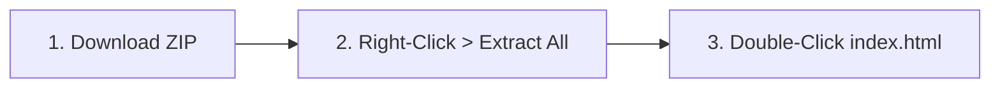
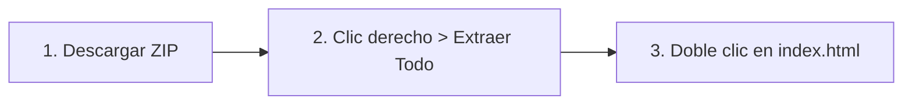

# 📖 START HERE: Official User Manual & Quick-Start Guide
# 📘 EMPIEZA AQUÍ: Manual Oficial de Usuario y Guía de Inicio Rápido
**Master Business Dashboard (Executive Financial Control System) — Version 1.4.0**  
*Official Release Date: October 27, 2026*  
*Author & Lead Engineer: Victor Montoya Rojas ([@goanarchy](https://www.linkedin.com/in/victormontoyarojas/)) | Direct Support: `andres00787@gmail.com`*

---

> ### 🌐 Language Selector / Selector de Idioma
> * 🇺🇸 **[Read in English (Click Here)](#-english-user-manual)**
> * 🇪🇸 **[Leer en Español (Haz Clic Aquí)](#-manual-de-usuario-en-español)**

---

# 🇺🇸 Master Business Dashboard — User Manual (v1.4.0)

## 🎯 Purpose of this Manual
This manual gives NJ local business owners, trade contractors, general contractors, and service companies in New Jersey a straightforward, step-by-step roadmap to master the **Master Business Dashboard (v1.4.0)** without financial guesswork or technical frustration. By following this guide, you will be able to:
1. Track user contracts, progress billing, down payment deposits, and remaining balances.
2. Link user invoices directly to material purchase orders and subcontractor bills to compute **real-time Job Costing & Project Profitability** ($ and % margins).
3. Apply statutory **NJ Form ST-8 Capital Improvement Exemptions (0% Sales Tax)** with complete compliance audit trails.
4. Verify **1099 Subcontractor Certificates of Insurance (COI)** to protect your business from costly New Jersey Workers' Compensation annual audit penalties.
5. Generate **1-Click Branded Printable Invoices & Estimates** formatted for user presentation and PDF saving.
6. Use the **Two-Way Excel Import Engine** to upload and sync modified `.xls`/`.xlsx` workbooks directly into your dashboard.
7. Work seamlessly in **Microsoft Excel** with **Native Formula Protection** that safely locks calculation cells while leaving input fields open.

---

## 📦 What to Do With Your Files Upon Download or Email
When you receive your package (`SBBT_v1.4.0_Ready_To_Use.zip`) via email, direct download link, or USB drive, follow these 3 simple setup steps:

1. **Extract the ZIP Folder**: Right-click `SBBT_v1.4.0_Ready_To_Use.zip` and select **"Extract All..."** (or *Descomprimir*). Choose any folder on your computer (e.g., Desktop or Documents).
2. **Launch the Web Dashboard**: Double-click **`index.html`**. It opens immediately in Google Chrome, Microsoft Edge, Safari, or Mozilla Firefox.
3. **Optional Native Excel**: If you prefer working inside Microsoft Excel, double-click **`NJ_Small_Business_Budget_v1.4.0.xls`**. Formula cells are locked and protected; light-blue cells are ready for your numbers.

> [!IMPORTANT]
> **Zero Installation & 100% Data Privacy**: You do **not** need a web server, cloud database, or active internet connection. All calculations, SheetJS imports, and exports run 100% locally in your browser. Your confidential business numbers never leave your personal computer.

---

## ⚡ 3-Step Quick Start (Achieve Results in 60 Seconds)

If you don't have time to read the entire guide, do these 3 steps right now:

1. **Step 1 — Set Your Month & Year**: At the top header, pick your active month (e.g., **October**) and fiscal year (**2025**). All tables and charts synchronize to this timeframe.
2. **Step 2 — Record a Contract or Invoice**: Click the **💵 Invoicing & Sales** tab. Click **➕ Add Invoice / Contract**. Enter the user name, project name, select the date via dropdowns, and enter contract amount and deposit received:
   * Select `"Deposit / Active"` if work is underway and you received an initial retainer.
   * Select `"Quote / Sent"` if it is an estimate pending customer approval.
   * Select `"Paid in Full"` once the entire balance is received.
3. **Step 3 — Inspect Your Job Profitability & Cash Position**: Click the **📈 Dashboard** tab. Review your **Job Costing & Project Profitability** table to see your exact gross margin on every contract, and review your **Net Profit in Hand** and **Inflow vs Outflow** comparative bar chart.

---

## 📑 Table of Contents
1. [Prerequisites: What You Need Before Starting](#en-prerequisites)
2. [Accounting & Visual Cell Conventions](#en-conventions)
3. [Step-by-Step Functional Guide](#en-steps)
   * [3.1 Header Controls, Fiscal Period & Module Manager](#en-header)
   * [3.2 Tab 1: Executive Dashboard (AR Alerts, Job Costing & Inflows/Outflows)](#en-tab1)
   * [3.3 Tab 2: Revenue, Progress Billing & Printable Invoices (NJ ST-8)](#en-tab2)
   * [3.4 Tab 3: Project COGS & Job Material Bills](#en-tab3)
   * [3.5 Tabs 4 to 8: Operating Expenses & 1099 COI Audit Sentinel](#en-tab4-8)
   * [3.6 Tab 9: NJ Taxes & Safe Harbor Reserves](#en-tab9)
   * [3.7 Tab 10: 12-Month Consolidated P&L Rollup](#en-tab10)
   * [3.8 Tab 11: Non-Destructive What-If Sandbox](#en-tab11)
   * [3.9 System Tools Hub (Excel Importer, Protected Excel Export & Backups)](#en-tools)
4. [Troubleshooting Guide (Cause & Effect)](#en-troubleshooting)
5. [Glossary & New Jersey Statutory Annex](#en-glossary)

---

## 1. Prerequisites: What You Need Before Starting
* **Any Modern Web Browser**: Google Chrome, Microsoft Edge, Safari, Brave, or Firefox.
* **Display Resolution**: Optimized for desktop/laptop screens (1280x720 or higher).
* *(Optional)* **Microsoft Excel or LibreOffice**: Only needed if you wish to inspect the companion `.xls` spreadsheet or open exported workbooks.

---

## 2. Accounting & Visual Cell Conventions
To prevent formula corruption and provide immediate visual clarity, cells follow strict visual rules:

| Visual Appearance | Meaning | How to Interact |
|---|---|---|
| 🔵 **Soft Light Blue (`#E0F2FE`)** | **Fillable User Input** | Click or double-click to edit. Press `Enter` or click outside to save. |
| ⚪ **Locked White/Slate (`#F8FAFC`)** | **Formula & Auto-Calculated** | **Protected & Locked**. Recomputes automatically in real time whenever an input changes. |
| 🟢 **Soft Green Badge** | **Healthy Margin / Paid** | Indicates collected invoices, profit margin > 35%, or compliant tax reserves. |
| 🟡 **Soft Amber Badge** | **Moderate Margin / Pending** | Indicates pending client balances or profit margin between 15% and 35%. |
| 🔴 **Soft Red Badge** | **Overdue / Audit Risk** | Indicates overdue past-due invoices, profit margin < 15%, or 1099 sub missing COI. |

---

## 3. Step-by-Step Functional Guide

### 3.1 Header Controls, Fiscal Period & Module Manager
* **Select Global Month & Year**: Click the dropdowns in the top header. Changing to `October 2025` instantly updates all dashboard metrics, variance calculations, and category tables.
* **Module & Discipline Manager (`⚙️ Modules`)**: Click this button in the top bar or in System Tools. Check only the financial disciplines your business operates (e.g. Turn off Fleet or Shop Facility if you are a solo contractor). Unchecked disciplines cleanly hide from the navigation bar and reports.
* **Two-Way Excel Importer (`📥 Import Excel`)**: Click this button anytime to upload a modified `.xls` or `.xlsx` file.

### 3.2 Tab 1: Executive Dashboard (AR Alerts, Job Costing & Inflows/Outflows)
* **Overdue Accounts Receivable Warning Banner**: If any invoice has the status `"Overdue"` and an outstanding balance, a prominent alert banner automatically appears at the top of the dashboard specifying the total dollar amount past due and number of invoices. Click **"Review Aging Invoices"** to jump directly to billing.
* **Job Costing & Project Profitability Analysis Card**: Directly correlates contract revenue with direct material POs and subcontractor bills matching the same **Project Name**. Displays Contract Value, Cash Collected, Direct COGS, Net Margin ($), Margin %, and health status (🟢 Healthy, 🟡 Moderate, 🔴 Low Margin).
* **Inflows vs Outflows Trajectory**:
  * **Annual (2 Cols)**: Compares Total Cash Collected vs Total Expenses.
  * **Last 3 Months**: Renders 3 mini charts showing month-over-month cash flow momentum.
* **Outflow Allocation Donut**: Visual percentage breakdown across Materials, Payroll, Facility, Insurance, Fleet, and Utilities.
* **Basic Essentials vs Advanced Details Switcher**: Basic mode gives you core totals; Advanced reveals cash runway months, safe-harbor tax gaps, and month-over-month variances.

### 3.3 Tab 2: Revenue, Progress Billing & Printable Invoices (NJ ST-8)
* **Progress Billing Fields**:
  * `Gross Contract Billed`: Total contract price agreed with client.
  * `Down Payment / Deposit`: Retainer received upfront before job commencement.
  * `Cash Collected`: Total actual payments received to date.
  * `Balance Due`: Auto-calculated remaining balance (`Total Due - Cash Collected`).
* **NJ Form ST-8 Capital Improvement Exemption**:
  * Construction, permanent remodeling, and capital installation work in New Jersey is **exempt from 6.625% sales tax** under N.J.S.A. 54:32B-3, provided the customer signs **Form ST-8 (Certificate of Capital Improvement)**.
  * Select `"ST-8 (0% - NJ Capital Improvement)"` in the tax classification dropdown to apply 0% sales tax legally with a documented audit trail.
* **1-Click Printable Client Invoice / Estimate (`🖨️ PDF`)**:
  * Every row has a `🖨️ PDF` button in the actions column.
  * Clicking it generates an executive, branded invoice sheet displaying Client details, Project scope, Tax Classification, Subtotal, Deposit applied, and Balance Due. Click **"Print / Save to PDF"** to create a client-ready PDF document!

### 3.4 Tab 3: Project COGS & Job Material Bills
* Track job site materials, lumber, electrical supplies, dumpsters, equipment rentals, and specialized subcontractor bills.
* Enter the **Project Name** (assisted by smart autocomplete). This automatically feeds into the **Job Costing Analysis** card on the dashboard!

### 3.5 Tabs 4 to 8: Operating Expenses & 1099 COI Audit Sentinel
* **Fleet & Travel (IRS $0.70/mi)**: Choose between actual fuel/tolls tracking or IRS standard mileage deduction.
* **Facility, Shop & Lease**: Track commercial shop lease, storage yard rent, CAM charges, or commercial mortgage P&I.
* **Insurance Policies**: Track mandatory NJ Workers' Compensation, Commercial General Liability (CGL), and Inland Marine tool floater policies with monthly amortized allocations.
* **Payroll & 1099 Subcontractor COI Sentinel**:
  * Supports W-2 staff (with automatic 10.9% employer tax calculation for FICA, NJ SUI, and FLI).
  * **1099 COI Audit Sentinel**: For 1099 subcontractors, track `COI Verified` vs `NO COI (Audit Risk ⚠️)`. Uninsured 1099 subs are flagged in bold red because New Jersey Workers' Comp auditors will assess full employee penalty surcharges on uninsured subcontractor payouts during your annual policy audit!
* **Utilities & Overhead**: PSE&G electric, gas, water, telecom, and SaaS software subscriptions.

### 3.6 Tab 9: NJ Taxes & Safe Harbor Reserves
* Track **ST-50 Quarterly Sales Tax** obligations and **CBT Corporate Business Tax** prepayments.
* Auto-calculates your **Tax Shortfall / Gap**: Displays `Safe Harbor Met` in green or flags remaining required reserves in red.

### 3.7 Tab 10: 12-Month Consolidated P&L Rollup
* Full 12-month consolidated financial statement tracking Gross Revenue, Cost of Goods Sold, Gross Profit Margin, Operating Expenses, and Net Cash Operating Profit.

### 3.8 Tab 11: Non-Destructive What-If Sandbox
* Unlock sliders to simulate +20% revenue growth, -10% material savings, or overhead increases. Calculations run in a safe sandbox that **never** touches your genuine business ledger.

### 3.9 System Tools Hub (Excel Importer, Protected Excel Export & Backups)
* **Two-Way Excel Import Engine**: Upload or drag-and-drop modified `.xls` or `.xlsx` files. All rows are parsed and immediately synchronized into the web dashboard!
* **Download Local Backup (`.json`)**: Save a snapshot of your entire business database to your hard drive.
* **Generate Executive Excel Workbook (`.xls`)**: Exports a multi-tab workbook with native formula protection.
* **Clear to Blank Slate ($0.00)**: Resets all categories to a pristine blank state for clean client deployment.

---

## 4. Troubleshooting Guide (Cause & Effect)

| Issue Observed | Root Cause | Solution |
|---|---|---|
| A newly added invoice doesn't appear in the table | Filter dropdown is set to a different month | Check the top filter. The app auto-syncs to the invoice date, but if set to a different month, select `All Months (YTD)` or the invoice's month. |
| Inflow chart shows $0 even with invoices entered | Invoices have status `"Pending"` or `"Quote / Sent"` | The Inflow chart measures **actual cash in hand**. Change the invoice status to `"Deposit / Active"` or `"Paid in Full"` once payment is received. |
| Job Costing table says "No active projects assigned yet" | Invoices and COGS lack project names | Enter a consistent Project Name (e.g. `Hoboken Brownstone Renovation`) in both Invoicing and COGS. |
| Payroll row displays red `⚠️ NO COI (Audit Risk)` badge | 1099 subcontractor has no insurance certificate | Collect a current Certificate of Insurance (COI) naming your firm as certificate holder and switch status to `COI Verified`. |
| Formula cell cannot be edited in Excel companion file | Native formula protection is active | Formula cells (`#F8FAFC`) are intentionally protected to prevent accidental calculation errors. Enter your numbers in the light-blue (`#E0F2FE`) cells. |

---

## 5. Glossary & New Jersey Statutory Annex
* **Job Costing**: Accounting method that tracks direct material, labor, and subcontractor expenses against a specific contract to calculate exact job profitability.
* **NJ Form ST-8 (Certificate of Capital Improvement)**: Official NJ Division of Taxation form certifying that work performed results in a capital improvement to real property, exempting the contract from NJ 6.625% sales tax.
* **COI (Certificate of Insurance)**: Standard ACORD document verifying that a 1099 subcontractor carries their own active General Liability and Workers' Comp coverage.
* **NJ HICPA (Home Improvement Contractor Registration)**: N.J.A.C. 13:45A-16 mandates all home improvement contractors register with the NJ Division of Consumer Affairs.
* **Safe Harbor**: Maintaining sufficient quarterly tax reserves to avoid underpayment penalties from the NJ Division of Taxation.

---
---

# 🇪🇸 Master Business Dashboard — Manual de Usuario (v1.4.0)

## 🎯 Propósito de este Manual
Este manual proporciona a contratistas, pequeñas empresas, profesionales de oficios y firmas de servicios en Nueva Jersey una guía completa y directa para dominar el **Master Business Dashboard (v1.4.0)** sin enredos técnicos ni dolores de cabeza contables. Al seguir esta guía aprenderás a:
1. Administrar contratos de usuarios, facturación progresiva, anticipos (depósitos iniciales) y saldos pendientes.
2. Enlazar tus facturas de usuarios con tus órdenes de compra de materiales y facturas de subcontratistas para calcular la **Rentabilidad de Obra (Job Costing)** con margen en dólares ($) y porcentaje (%).
3. Aplicar legalmente la **Exención de Mejora de Capital de NJ (Formulario ST-8 al 0% de Sales Tax)** con respaldo para auditorías.
4. Auditar los **Certificados de Seguro (COI)** de tus subcontratistas 1099 para protegerte de penalidades severas en la auditoría anual de Workers' Comp de Nueva Jersey.
5. Generar **Facturas y Presupuestos Imprimibles en 1 Clic**, con formato profesional listo para presentar a tu usuario o guardar en PDF.
6. Usar el **Motor de Importación Bidireccional de Excel** para subir y sincronizar hojas `.xls`/`.xlsx` directamente a tu tablero web.
7. Trabajar en **Microsoft Excel** con **Protección Nativa de Fórmulas**, donde las celdas de cálculo están bloqueadas y solo las celdas celestes son editables.

---

## 📦 Qué Hacer con los Archivos al Recibirlos por Correo o Enlace
Cuando descargues el paquete (`SBBT_v1.4.0_Ready_To_Use.zip`), sigue estos 3 pasos:

1. **Descomprimir la Carpeta ZIP**: Haz clic derecho sobre `SBBT_v1.4.0_Ready_To_Use.zip` y selecciona **"Extraer todo..."** (o *Extract All*). Elige cualquier carpeta de tu preferencia (Escritorio o Documentos).
2. **Abrir el Tablero Web**: Haz doble clic en el archivo **`index.html`**. Se abrirá de inmediato en Google Chrome, Microsoft Edge, Safari o Firefox.
3. **Archivo de Excel Opcional**: Si prefieres trabajar en Microsoft Excel tradicional, abre **`NJ_Small_Business_Budget_v1.4.0.xls`**. Las fórmulas están protegidas contra sobrescritura accidental; las celdas celestes están listas para tus números.

> [!IMPORTANT]
> **Cero Instalación y Privacidad Total**: No necesitas servidores, bases de datos ni conexión a internet. La aplicación corre 100% dentro de tu navegador de manera privada. Tus números financieros confidenciales jamás salen de tu computadora.

---

## ⚡ Guía de Inicio Rápido en 3 Pasos (Resultados en 60 Segundos)

Si no tienes tiempo para leer todo el manual, haz estos 3 pasos ahora mismo:

1. **Paso 1 — Elige Mes y Año**: En el encabezado superior, selecciona tu mes activo (ej. **October**) y año fiscal (**2025**). Todas las tablas y gráficos se sincronizarán con este período.
2. **Paso 2 — Registra un Contrato o Factura**: Ve a la pestaña **💵 Invoicing & Sales**. Haz clic en **➕ Add Invoice / Contract**. Ingresa el usuario, nombre del proyecto, fecha mediante menús desplegables, valor del contrato y depósito recibido:
   * Elige `"Deposit / Active"` si el proyecto inició y recibiste un anticipo.
   * Elige `"Quote / Sent"` si es un presupuesto enviado pendiente de aprobación.
   * Elige `"Paid in Full"` cuando el usuario haya liquidado la totalidad del trabajo.
3. **Paso 3 — Consulta tu Rentabilidad por Proyecto y Dinero en Caja**: Ve a **📈 Dashboard**. Observa la tabla de **Job Costing & Project Profitability** para ver el margen neto exacto de cada obra, y revisa tu **Ganancia Neta en Mano** y el gráfico comparativo de Ingresos vs Egresos.

---

## 📑 Tabla de Contenidos Navegable
1. [Prerrequisitos: Qué Necesitas Antes de Empezar](#es-prerrequisitos)
2. [Convenciones Contables y Código de Colores](#es-convenciones)
3. [Instrucciones Paso a Paso de Cada Función](#es-pasos)
   * [3.1 Controles Superiores, Período Fiscal y Gestor de Módulos](#es-header)
   * [3.2 Pestaña 1: Dashboard Ejecutivo (Alertas de Cobranza, Rentabilidad de Obra y Flujos)](#es-tab1)
   * [3.3 Pestaña 2: Facturación, Facturación Progresiva y Facturas PDF (NJ ST-8)](#es-tab2)
   * [3.4 Pestaña 3: Costos Directos (COGS) y Facturas de Materiales](#es-tab3)
   * [3.5 Pestañas 4 a 8: Gastos Operativos y Centinela de Seguros 1099](#es-tab4-8)
   * [3.6 Pestaña 9: Impuestos de NJ y Reservas Safe Harbor](#es-tab9)
   * [3.7 Pestaña 10: Estado de Pérdidas y Ganancias (P&L 12 Meses)](#es-tab10)
   * [3.8 Pestaña 11: Simulador Sandbox No Destructivo](#es-tab11)
   * [3.9 Centro de Herramientas del Sistema (Importador de Excel, Exportación Protegida y Respaldos)](#es-tools)
4. [Solución de Problemas (Causa y Efecto)](#es-solucion-problemas)
5. [Glosario y Anexo Legal de Nueva Jersey](#es-glosario)

---

## 1. Prerrequisitos: Qué Necesitas Antes de Empezar
* **Cualquier Navegador Moderno**: Google Chrome, Microsoft Edge, Safari, Brave o Firefox.
* **Resolución de Pantalla**: Diseñado para computadoras portátiles o de escritorio (1280x720 o superior).
* *(Opcional)* **Microsoft Excel o LibreOffice**: Solo necesario si deseas abrir el archivo `.xls` o las exportaciones generadas.

---

## 2. Convenciones Contables y Código de Colores
Para evitar corrupción de fórmulas y brindar máxima claridad visual, las celdas siguen un estricto código visual:

| Apariencia Visual | Significado | Cómo Interactuar |
|---|---|---|
| 🔵 **Azul Claro Suave (`#E0F2FE`)** | **Dato Editable por el Usuario** | Haz clic o doble clic para editar. Presiona `Enter` o haz clic afuera para guardar. |
| ⚪ **Blanco/Pizarra Bloqueado (`#F8FAFC`)** | **Fórmula y Cálculo Automático** | **Protegido y Bloqueado**. Se recalcula automáticamente en tiempo real al ingresar datos. |
| 🟢 **Insignia Verde Suave** | **Margen Saludable / Pagado** | Facturas cobradas, margen de proyecto > 35%, o reservas fiscales al día. |
| 🟡 **Insignia Ámbar Suave** | **Margen Moderado / Pendiente** | Facturas con saldo pendiente o margen de proyecto entre 15% y 35%. |
| 🔴 **Insignia Roja Suave** | **Vencido / Riesgo de Auditoría** | Facturas vencidas en mora, margen < 15%, o subcontratista 1099 sin seguro (COI). |

---

## 3. Instrucciones Paso a Paso de Cada Función

### 3.1 Controles Superiores, Período Fiscal y Gestor de Módulos
* **Seleccionar Mes y Año Global**: Cambia el menú del encabezado. Seleccionar `October 2025` actualiza al instante todos los totales, rentabilidades y tablas.
* **Gestor de Módulos (`⚙️ Modules`)**: Haz clic en este botón para seleccionar qué categorías utiliza tu empresa (por ejemplo, desactiva Flota o Instalaciones si trabajas como contratista independiente). Las pestañas inactivas se ocultan de forma limpia.
* **Importador de Excel (`📥 Import Excel`)**: Permite subir un archivo `.xls` o `.xlsx` modificado para actualizar tu sistema web.

### 3.2 Pestaña 1: Dashboard Ejecutivo (Alertas de Cobranza, Rentabilidad de Obra y Flujos)
* **Banner de Alerta de Cuentas por Cobrar Vencidas**: Si existe alguna factura con estado `"Overdue"` y saldo pendiente, aparece un banner de advertencia con el monto total adeudado y número de facturas. Incluye un botón para ir directamente a cobranzas.
* **Tarjeta de Rentabilidad por Proyecto (Job Costing)**: Vincula automáticamente tus facturas cobradas con los gastos directos de materiales y subcontratistas que tengan el mismo **Nombre de Proyecto**. Muestra el Valor del Contrato, Cobrado, Costos Directos, Ganancia Neta ($), Margen (%) y estado de salud financiera.
* **Gráfico de Ingresos vs Egresos**:
  * **Anual (2 Columnas)**: Dinero Cobrado en Mano vs Gastos Totales.
  * **Últimos 3 Meses**: 3 mini gráficos con la evolución del flujo de caja mes a mes.
* **Gráfico de Dona de Asignación de Gastos**: Muestra la distribución porcentual entre Materiales, Nómina, Renta/Hipoteca, Seguros, Vehículos y Servicios.
* **Modo Básico vs Detalles Avanzados**: El modo Básico muestra lo esencial; el modo Avanzado despliega meses de reserva de caja (runway) y brecha fiscal.

### 3.3 Pestaña 2: Facturación, Facturación Progresiva y Facturas PDF (NJ ST-8)
* **Campos de Facturación Progresiva**:
  * `Gross Contract Billed`: Valor total presupuestado del contrato.
  * `Down Payment / Deposit`: Anticipo recibido al firmar antes de comenzar obra.
  * `Cash Collected`: Total de abonos o pagos recibidos a la fecha.
  * `Balance Due`: Saldo pendiente calculado automáticamente (`Total Due - Cash Collected`).
* **Exención de Mejora de Capital (NJ Form ST-8 al 0%)**:
  * En Nueva Jersey, las obras de construcción y remodelación permanente a bienes raíces están **exentas del impuesto sobre ventas del 6.625%** bajo la ley N.J.S.A. 54:32B-3, siempre que el usuario firme el **Formulario ST-8**.
  * Selecciona `"ST-8 (0% - NJ Capital Improvement)"` en la columna de impuestos para facturar al 0% con total respaldo legal.
* **Generador de Facturas y Presupuestos en 1 Clic (`🖨️ PDF`)**:
  * Cada fila cuenta con un botón `🖨️ PDF`.
  * Al presionarlo, genera una factura formal con los datos del usuario, alcance del proyecto, desglose de impuestos, anticipos aplicados y saldo pendiente, lista para imprimir o guardar como PDF.

### 3.4 Pestaña 3: Costos Directos (COGS) y Facturas de Materiales
* Registra compras de materiales, madera, suministros de plomería o electricidad, alquiler de contenedores y facturas de subcontratistas de obra.
* Escribe el **Nombre del Proyecto** (con autocompletado inteligente). ¡Esto alimentará de inmediato la tabla de **Job Costing** en el Dashboard!

### 3.5 Pestañas 4 a 8: Gastos Operativos y Centinela de Seguros 1099
* **Flota y Vehículos (Tarifa IRS $0.70/milla)**: Permite elegir entre registro de gastos reales de gasolina o deducción estándar de millaje del IRS.
* **Instalaciones, Taller y Alquiler**: Control de arrendamiento de bodega, patio de almacenamiento, cuotas CAM o hipoteca comercial.
* **Pólizas de Seguros**: Pólizas obligatorias de Workers' Compensation de NJ, Responsabilidad Civil General (CGL) y seguro de herramientas con amortización mensual.
* **Nómina y Centinela de Subcontratistas 1099**:
  * Empleados W-2 (con cálculo automático del 10.9% de impuestos patronales: FICA, NJ SUI y FLI).
  * **Centinela de Auditoría 1099**: Para contratistas independientes 1099, registra `COI Verified` o `NO COI (Audit Risk ⚠️)`. Aquellos sin seguro vigente se destacan en rojo, ya que en la auditoría anual de Workers' Comp de NJ el auditor cobrará recargos severos por subcontratistas sin póliza propia.
* **Servicios Públicos y Software**: Facturas de electricidad (PSE&G), agua, internet, telefonía y suscripciones de software.

### 3.6 Pestaña 9: Impuestos de NJ y Reservas Safe Harbor
* Control de pagos trimestrales del impuesto sobre ventas **ST-50** y pagos estimados del **CBT (Corporation Business Tax)**.
* Calcula la **Brecha Fiscal**: Informa en verde si cumpliste el Safe Harbor o en rojo si requieres fondear más reservas.

### 3.7 Pestaña 10: Estado de Pérdidas y Ganancias (P&L 12 Meses)
* Estado financiero completo a 12 meses que consolida Ingresos Facturados, Costos de Materiales, Margen Bruto, Gastos Operativos y Ganancia Operativa Neta en Mano.

### 3.8 Pestaña 11: Simulador Sandbox No Destructivo
* Proyecta escenarios de crecimiento o reducción de costos mediante controles deslizantes. El simulador opera en un entorno seguro y **nunca** altera tus datos contables reales.

### 3.9 Centro de Herramientas del Sistema (Importador de Excel, Exportación Protegida y Respaldos)
* **Motor de Importación de Excel**: Sube o arrastra tu archivo `.xls` o `.xlsx` modificado. Todos los registros se integran automáticamente en el tablero web.
* **Descargar Respaldo Local (`.json`)**: Guarda una copia de seguridad íntegra de toda tu información en tu disco duro.
* **Generar Hoja Oficial de Excel (`.xls`)**: Exporta tu libro de trabajo con protección nativa de fórmulas.
* **Limpiar a Plantilla en Blanco ($0.00)**: Deja todas las hojas en $0.00 limpias para entregar al usuario.

---

## 4. Solución de Problemas (Causa y Efecto)

| Problema Observado | Causa Raíz | Solución |
|---|---|---|
| Agrego una factura y no se ve en la tabla | El filtro de mes está configurado en otro período | Revisa el menú superior. La aplicación auto-sincroniza al mes de la factura, pero si cambiaste de mes manualmente, selecciona `All Months (YTD)` o el mes correspondiente. |
| El gráfico de ingresos marca $0 aunque tengo facturas | Las facturas tienen estado `"Pending"` o `"Quote / Sent"` | El gráfico mide **dinero real en caja**. Cambia el estado a `"Deposit / Active"` o `"Paid in Full"` cuando el usuario realice el pago. |
| La tabla de Job Costing dice que no hay proyectos asignados | Las facturas y materiales no tienen nombre de proyecto | Asigna el mismo Nombre de Proyecto (ej. `Renovación Casa Morristown`) en las facturas y en la pestaña de COGS. |
| Una fila de nómina muestra `⚠️ NO COI (Audit Risk)` | El subcontratista 1099 no tiene certificado de seguro | Solicita a tu subcontratista su Certificado de Seguro (COI) vigente con tu empresa como titular y cambia su estado a `COI Verified`. |
| No puedo editar una celda de fórmula en el archivo Excel | La protección nativa de fórmulas está activa | Las celdas de fórmulas (`#F8FAFC`) están protegidas para evitar errores contables. Ingresa tus números en las celdas celestes (`#E0F2FE`). |

---

## 5. Glosario y Anexo Legal de Nueva Jersey
* **Job Costing (Costeo por Proyecto)**: Método contable que vincula materiales, mano de obra y subcontratistas a un contrato específico para conocer la rentabilidad neta real de cada obra.
* **NJ Form ST-8 (Certificado de Mejora de Capital)**: Documento oficial de la División de Tributación de Nueva Jersey que certifica que el trabajo realizado constituye una mejora permanente al inmueble, eximiendo el contrato del 6.625% de Sales Tax.
* **COI (Certificado de Seguro)**: Documento estándar ACORD que prueba que un subcontratista cuenta con su propia póliza activa de Responsabilidad Civil y Workers' Compensation.
* **NJ HICPA (Registro de Contratistas de Obras Residenciales)**: La normativa N.J.A.C. 13:45A-16 exige que todo contratista de mejoras del hogar esté registrado ante la División de Asuntos del Consumidor de NJ.
* **Safe Harbor**: Mantenimiento de fondos suficientes para pagos trimestrales estimados que evitan penalidades por pago insuficiente ante el Estado de NJ.
