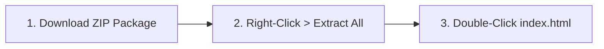

# 📖 Master Business Dashboard — Official User Manual (v1.5.0)
**Executive Financial Control System for New Jersey Local Businesses & Trade Contractors**  
*Official Release: Version 1.4.1*  
*Author & Lead Engineer: [Victor Montoya Rojas](https://www.linkedin.com/in/victormontoyarojas/) | Support: `andres00787@gmail.com`*

---

> ### 🌐 Looking for Spanish? / ¿Prefiere leer en Español?
> Para consultar el manual oficial completo en idioma español, abra el archivo separado: **[MANUAL_DE_USUARIO_ES.md](file:///c:/Users/Andr%C3%A9s%20Montoya/.gemini/antigravity-ide/scratch/nj-business-budget-v1/MANUAL_DE_USUARIO_ES.md)**.

---

## 🎯 Purpose of this Manual
This manual provides New Jersey trade contractors, general contractors, commercial specialty trades, and local business owners with a clear, step-by-step operational roadmap to master the **Master Business Dashboard (v1.5.0)** without accounting jargon or technical frustration.

By following this guide, you will be able to:
1. **Track Contracts, Retainers & Progress Billing**: Manage user accounts, down payment deposits, progress billings, and outstanding balances with the newly added `"Accepted"` status option for approved quotes.
2. **Execute Real-Time Job Costing & Profit Margins**: Correlate user billings directly with material bills and subcontractor invoices matching the same **PROJECT / Project Name** to compute net profit ($) and gross margin (%) instantly.
3. **Navigate Trading Exchange-Precision Financial Dashboards**: View your financial vitals in structured, compact trading exchange-style tiles that eliminate loose numbers and cluttered layouts.
4. **Leverage Dynamic Navigation Tabs**: Enable only the business modules you actively use; unneeded tabs disappear immediately from the navigation strip so you only see what you are working on.
5. **Apply NJ Form ST-8 Capital Improvement Exemptions (0% Sales Tax)**: Legally exempt qualified capital installation and construction work under N.J.S.A. 54:32B-3 with an auditable compliance trail.
6. **Enforce the 1099 Subcontractor COI Sentinel**: Flag uninsured independent subcontractors in bold red before annual New Jersey Workers' Compensation policy audits assess heavy surcharges.
7. **Generate 1-Click Printable PDF Invoices & Estimates**: Produce clean, branded invoices and proposals ready to print or save to PDF directly in your browser.
8. **Work Seamlessly in Microsoft Excel**: Use the included `NJ_Small_Business_Budget_v1.5.0.xls` workbook with built-in cell protection that locks formulas while leaving input cells open.

---

## 📦 What to Do With Your Files Upon Download or Email
When you receive your official release package (`SBBT_v1.5.0_Ready_To_Use.zip`) via email, direct download link, or USB drive, follow these 3 setup steps:

1. **Extract the ZIP Package**: Right-click `SBBT_v1.5.0_Ready_To_Use.zip` and select **"Extract All..."**. Choose any folder on your computer (such as your Desktop or Documents).
2. **Launch the Master Web Dashboard**: Double-click **`index.html`**. It opens immediately in Google Chrome, Microsoft Edge, Safari, Brave, or Mozilla Firefox.
3. **Optional Native Excel Companion**: If you prefer working directly inside Microsoft Excel, double-click **`NJ_Small_Business_Budget_v1.5.0.xls`**. Formulas are locked and protected; light-blue cells are ready for your data.

> [!IMPORTANT]
> **Zero Installation & 100% Data Privacy**: You do **not** need a web server, cloud database, or active internet connection. All calculations, SheetJS imports, and exports run 100% locally in your browser. Your confidential business numbers never leave your computer.

---

## ⚡ 3-Step Quick Start (Up & Running in 60 Seconds)

If you need results right away, follow these 3 steps:

1. **Step 1 — Set Your Active Month & Year**: In the top header, pick your active month (e.g., **October**) and fiscal year (**2025**). All tables and charts synchronize to this timeframe.
2. **Step 2 — Record a Contract or Invoice**:
   * Click the **💵 Invoicing & Sales** tab.
   * Click **➕ Add Invoice / Contract**.
   * Enter the user account name, job name, date (via dropdowns), contract value, and deposit received.
   * Select status:
     * `"Accepted"` if the user approved your proposal and work order is confirmed.
     * `"Deposit / Active"` if initial retainer is collected and work is underway.
     * `"Quote / Sent"` if an estimate is pending approval.
     * `"Paid in Full"` once the entire contract balance is received in the bank.
3. **Step 3 — Inspect Your Job Profitability & Trading Exchange Dashboard**: Click the **📈 Dashboard** tab. Review your **Job Costing & Project Profitability** table to see your exact gross margin on every contract, and check the compact trading exchange stat tiles for liquid cash, accounts receivable aging, and tax reserves.

---

## 📑 Table of Contents
1. [Prerequisites & System Compatibility](#1-prerequisites--system-compatibility)
2. [Accounting & Visual Cell Conventions](#2-accounting--visual-cell-conventions)
3. [Step-by-Step Functional Guide](#3-step-by-step-functional-guide)
   * [3.1 Header Navigation, Period Selectors & Dynamic Module Wizard](#31-header-navigation-period-selectors--dynamic-module-wizard)
   * [3.2 Tab 1: Executive Dashboard (Trading Exchange Tiles & Job Costing)](#32-tab-1-executive-dashboard-trading-exchange-tiles--job-costing)
   * [3.3 Tab 2: Invoicing & Sales, "Accepted" Status & Printable Invoices (NJ ST-8)](#33-tab-2-invoicing--sales-accepted-status--printable-invoices-nj-st-8)
   * [3.4 Tab 3: Project COGS & Job Material Bills](#34-tab-3-project-cogs--job-material-bills)
   * [3.5 Tabs 4 to 8: Operating Expenses & 1099 COI Audit Sentinel](#35-tabs-4-to-8-operating-expenses--1099-coi-audit-sentinel)
   * [3.6 Tab 9: NJ Taxes & Safe Harbor Reserves (ST-50 & CBT)](#36-tab-9-nj-taxes--safe-harbor-reserves-st-50--cbt)
   * [3.7 Tab 10: 12-Month Consolidated P&L Rollup](#37-tab-10-12-month-consolidated-pl-rollup)
   * [3.8 Tab 11: Non-Destructive What-If Sandbox](#38-tab-11-non-destructive-what-if-sandbox)
   * [3.9 System Tools Hub (Excel Importer, Protected Excel Export & Backups)](#39-system-tools-hub-excel-importer-protected-excel-export--backups)
4. [Troubleshooting Guide (Cause & Effect)](#4-troubleshooting-guide-cause--effect)
5. [Glossary & New Jersey Statutory Annex](#5-glossary--new-jersey-statutory-annex)

---

## 1. Prerequisites & System Compatibility
* **Web Browser**: Any modern browser (Google Chrome, Microsoft Edge, Mozilla Firefox, Apple Safari, Brave).
* **Operating System**: Windows 10/11, macOS, Linux, iPadOS, or ChromeOS.
* **Screen Resolution**: Optimized for desktop and laptop displays (1280×720 or higher).
* *(Optional)* **Spreadsheet Software**: Microsoft Excel 2016+, Office 365, or LibreOffice Calc if opening `.xls`/`.xlsx` files directly.

---

## 2. Accounting & Visual Cell Conventions
To prevent calculation errors and provide instant visual clarity, cells follow strict visual rules:

| Visual Appearance | Meaning | How to Interact |
|---|---|---|
| 🔵 **Soft Sky Blue (`#E0F2FE`)** | **Fillable User Input** | Click or double-click to edit. Press `Enter` or click outside to save. |
| ⚪ **Locked White/Slate (`#F8FAFC`)** | **Formula & Auto-Calculated** | **Protected & Locked**. Recomputes automatically in real time whenever an input changes. |
| 🟢 **Soft Green Badge** | **Healthy Margin / Paid** | Indicates collected invoices, profit margin > 35%, or compliant tax reserves. |
| 🟡 **Soft Amber Badge** | **Moderate Margin / Pending** | Indicates pending client balances or profit margin between 15% and 35%. |
| 🔴 **Soft Red Badge** | **Overdue / Audit Risk** | Indicates overdue past-due invoices, profit margin < 15%, or 1099 sub missing COI. |

---

## 3. Step-by-Step Functional Guide

### 3.1 Header Navigation, Period Selectors & Dynamic Module Wizard
* **Fiscal Period Selector**: Click the Month and Year dropdowns in the top header. Selecting `October 2025` synchronizes all dashboard metrics, variance calculations, and category tables to that month. You can also select `All Months (YTD)` for full-year totals or `Trailing 12 Months (T12M)` for rolling 12-month analysis.
* **Dynamic Module Wizard (`⚙️ Modules`)**: Click **"⚙️ Modules"** in the top bar. Check only the financial disciplines your business operates (e.g., uncheck Fleet if you don't operate company vehicles, or uncheck Facility if you work remotely). When an unneeded module is turned OFF, its navigation tab immediately vanishes from the navigation strip so your workspace stays uncluttered.
* **Onboarding Welcome Dialog**: On first launch, an interactive welcome modal introduces the system. It maintains fixed, stable dimensions across all steps. Clicking **"💡 How to Start"** closes the welcome modal smoothly before opening the 4-step quick start guide, preventing overlapping windows.

### 3.2 Tab 1: Executive Dashboard (Trading Exchange Tiles & Job Costing)
* **Trading Exchange Precision Stat Tiles**: In Advanced Mode, financial indicators are organized into clean, high-precision metric tiles inspired by financial trading terminals:
  * **AR Aging & Collection Health**: Displays Total Billed, Active Current AR, and Past-Due Overdue in dedicated lateral tiles with monospace typography.
  * **Category Spending & OpEx Distribution**: Displays Direct Job COGS, Fixed Overhead (OpEx), and OpEx Allocation Ratio in compact side-by-side tiles.
  * **Cash Runway & Operating Liquidity**: Displays Liquid Reserves, Monthly Operating Burn, and Working Capital Buffer.
  * **NJ Safe Harbor Tax Sentinel**: Displays Reserve Funded, Estimated Total Due, and Reserve Shortfall Gap.
* **Job Costing & Project Profitability Card**: Matches revenue rows with COGS material bills sharing the same **PROJECT**. It shows Contract Billed, Cash Collected, Direct Costs, Net Margin ($), Gross Margin (%), and visual health status badges.
* **Overdue Accounts Receivable Banner**: Automatically alerts you with total dollars past due whenever an invoice is overdue.

### 3.3 Tab 2: Invoicing & Sales, "Accepted" Status & Printable Invoices (NJ ST-8)
* **New "Accepted" Status Option**: The status dropdown now includes `"Accepted"` for approved proposals and contracts that have been confirmed by the user before deposit or mobilization.
  * Status options: `"Paid in Full"`, `"Deposit / Active"`, `"Pending Balance"`, `"Accepted"`, `"Quote / Sent"`, `"Overdue"`.
* **Optional PROJECT Field**: Tag each invoice with an optional PROJECT (e.g., `Hoboken Brownstone Electrical Upgrade`) to match with project expenses.
* **NJ Form ST-8 Capital Improvement Exemption**: Under N.J.S.A. 54:32B-3, permanent capital improvement construction in New Jersey is exempt from 6.625% sales tax when supported by Form ST-8. Select `"ST-8 (0% - NJ Capital Improvement)"` in the tax dropdown to apply 0% sales tax with full audit compliance.
* **1-Click Printable PDF Invoices (`🖨️ PDF`)**: Click `🖨️ PDF` on any invoice row to open a formatted invoice sheet. For `"Accepted"` jobs, it displays **"ACCEPTED WORK ORDER & CONTRACT"**; for quotes, **"CONTRACT ESTIMATE & PROPOSAL"**; and for invoices, **"INVOICE / BILL OF WORK"**.

### 3.4 Tab 3: Project COGS & Job Material Bills
* Track job site materials, lumber, electrical supplies, dumpsters, equipment rentals, and direct subcontractor labor.
* Enter the **PROJECT (Required)** with predictive autocomplete to link expenses directly to your Job Costing analysis on the dashboard.

### 3.5 Tabs 4 to 8: Operating Expenses & 1099 COI Audit Sentinel
* **Fleet & Travel (IRS $0.70/mi)**: Switch between actual fuel/repair receipts or IRS standard mileage tracking.
* **Facility, Shop & Lease**: Track commercial shop rent, yard storage, CAM charges, or commercial mortgage P&I.
* **Insurance Policies**: Track mandatory NJ Workers' Compensation, Commercial General Liability (CGL), and Inland Marine tool policies with automatic monthly amortization.
* **Payroll & 1099 Subcontractor COI Sentinel**:
  * Track W-2 staff with automatic 10.9% employer payroll tax calculations (FICA, NJ SUI, and FLI).
  * **1099 COI Audit Sentinel**: For 1099 subcontractors, track `COI Verified` vs `NO COI (Audit Risk ⚠️)`. Uninsured subs are highlighted in bold red to protect you from New Jersey Workers' Comp audit penalty surcharges.
* **Utilities & SaaS**: Electricity (PSE&G), gas, water, internet, and software subscriptions.

### 3.6 Tab 9: NJ Taxes & Safe Harbor Reserves (ST-50 & CBT)
* Track quarterly **ST-50 Sales Tax** liabilities and estimated **CBT (Corporation Business Tax)** prepayments.
* Auto-calculates your **Safe Harbor Gap**: Displays `Safe Harbor Met` in green or highlights reserve shortfalls in red.

### 3.7 Tab 10: 12-Month Consolidated P&L Rollup
* Complete 12-month financial statement consolidating Gross Revenue, Cost of Goods Sold, Gross Profit Margin, Operating Overhead, and Net Cash Operating Profit.

### 3.8 Tab 11: Non-Destructive What-If Sandbox
* Adjust revenue and cost sliders to model business growth or cost reductions. Calculations run in a safe sandbox that never alters your actual business data.

### 3.9 System Tools Hub (Excel Importer, Protected Excel Export & Backups)
* **Two-Way Excel Import Engine**: Upload modified `.xls` or `.xlsx` workbooks to sync data into the web dashboard.
* **Download Local Backup (`.json`)**: Save an instant snapshot of your database to your local drive.
* **Generate Official Excel Workbook (`.xls`)**: Exports a protected multi-tab Excel spreadsheet.
* **Reset to Blank Template ($0.00)**: Clears all demo entries for live client delivery.

---

### 3.10 Company Profile & Document Branding Settings (`🏢 Company Profile`)
* **Personalized Document Header**: Click **"🏢 Company Profile"** in the top navigation bar or under **System Tools** to customize your business identity.
* **Standard Business Fields (Non-Private)**:
  - **Company / Trade Name**: Printed as the primary business header on all invoices and reports.
  - **Specialty / Trade Tagline**: Displayed beneath your business name (e.g., *Licensed Commercial Electrical & Low-Voltage Contractor*).
  - **Street Address, City, State, ZIP**: Fully formats formal address blocks.
  - **Direct Business Phone & Email**: Instant contact references for billing inquiries.
  - **Official Website**: Displayed on project proposals.
  - **NJ License # / HICPA Reg**: Critical compliance requirement under N.J.A.C. 13:45A-16 printed directly on PDF customer estimates and invoices.
* **Instant Persistence**: Saved directly into browser `localStorage` and automatically updates invoice printouts and Excel exports.

### 3.12 Dedicated "Project Cost Review" Tab & Interactive Inclusion Audit
* **Comprehensive Project Job Costing**: Access the dedicated **🏗️ Project Cost Review** tab from the top navigation.
* **Master Project Dropdown**: Select any customer contract created in *Invoicing & Sales* to inspect all direct costs assigned across all business disciplines (COGS Materials, Subcontractors, Dedicated Payroll, Vehicle Fuel/Tolls, and Facilities).
* **Progressive Budget Consumption Meter**: Displays real-time cost consumption percentage against contract value with color alerts (🟢 <65% Healthy, 🟡 65-85% Caution, 🔴 >85% Overrun Risk).
* **Interactive Inclusion Checkboxes (`[x]`)**: Every cost line features a checkbox. Unchecking any line instantly excludes it from the project sum and recalculates net profit and budget progress in real time.

### 3.14 Reorganized Header Controls & 100% OFFLINE Operations
* **100% OFFLINE Architecture**: The system operates completely offline in your local browser. No data is transmitted to external servers, ensuring maximum privacy and security.
* **Streamlined Header Clusters**:
  - **Setup Group**: `💡 How to Start`, `🏢 Company Profile`, and `⚙️ Modules`.
  - **File Operations (Side-by-Side)**: `📂 OPEN` (import existing spreadsheets) and `💾 SAVE AS NEW FILE` (export new consecutive Excel workbooks without overwriting previous versions).
  - **Utility & Help (Right Corner)**: `🌙 Theme`, `🚀 What's New`, and `❓ Help` (opens the Help Center modal to choose English or Spanish manuals).
* **Decoupled Period Selectors**: The master header period selector was removed. You can set the time period on the Executive Dashboard directly and within each category toolbar.

### 3.15 Mandatory PROJECT Creation & Auto-Consecutive Numbering
* **Mandatory Project Assignment**: When entering sales, estimates, or contracts in **💵 Invoicing & Sales**, entering the **PROJECT** is mandatory.
* **Automated Consecutive ID**: The system automatically prefixes a date/document consecutive number (e.g. `INV-2025-01 - Kitchen Remodel`).
* **Cross-Discipline Memory**: Projects created in Invoices & Sales are automatically remembered across the entire tool (COGS, Payroll, Fleet, Facility, Utilities) for job costing and profit review.

### 3.13 Universal Category Table Filtering & Search Strip
* **Instant Filter Strip**: Every category table (Invoices, COGS, Fleet, Facility, Insurance, Payroll, Utilities, Taxes) features a built-in search box and dynamic dropdowns.
* **Instant Search Box**: Filter rows by customer, vendor, payee, job name, or notes without losing typing focus.
* **Status & Project Dropdowns**: Isolate entries by status (e.g., Paid, Pending, Quote) or by specific customer contract.
* **1-Click Reset**: Click `✖ Clear Filters` to instantly reset to the full period view.

### 3.11 In-Place Row Editing (`✏️ Edit Button`)
* **Modify Any Record In-Place**: Every data table (Invoicing, COGS, Fleet, Facility, Insurance, Payroll, Utilities, Taxes) now features a dedicated **✏️ Edit** button alongside the delete button.
* **Smart Synchronized Modal**: Clicking `✏️` opens the entry modal with all original values pre-filled, automatically selecting the matching Month, Day, and Year dropdowns.
* **Zero Disruption**: Modify client names, amounts, tax classifications, or job descriptions and click **Save Changes** without having to delete the record or recalculate totals.

## 4. Troubleshooting Guide (Cause & Effect)

| Issue Observed | Root Cause | Solution |
|---|---|---|
| A newly added invoice doesn't appear in the table | Filter dropdown is set to a different month | Check the top filter. The app auto-syncs to the invoice date, but if set to a different month, select `All Months (YTD)` or the invoice's month. |
| Inflow chart shows $0 even with invoices entered | Invoices have status `"Pending"` or `"Quote / Sent"` | The Inflow chart measures **actual cash in bank**. Change status to `"Deposit / Active"` or `"Paid in Full"` once payment is received. |
| Job Costing table says "No active projects assigned yet" | Invoices and COGS lack matching job names | Enter the same PROJECT (e.g. `Morristown Commercial Fitout`) in both Invoicing and COGS. |
| Payroll row displays red `⚠️ NO COI (Audit Risk)` badge | 1099 subcontractor has no insurance certificate | Collect a current Certificate of Insurance (COI) naming your company as certificate holder and switch status to `COI Verified`. |
| Formula cell cannot be edited in Excel companion file | Native formula protection is active | Formula cells (`#F8FAFC`) are intentionally protected to prevent accidental calculation errors. Enter your numbers in the light-blue (`#E0F2FE`) cells. |
| Navigation tab is missing from the top bar | Module was turned off in Module Wizard | Click `⚙️ Modules` in the header or in System Tools and check the module to restore its tab immediately. |

---

## 5. Glossary & New Jersey Statutory Annex
* **Job Costing**: Accounting method that tracks direct material, labor, and subcontractor expenses against a specific contract to calculate exact job profitability.
* **NJ Form ST-8 (Certificate of Capital Improvement)**: Official NJ Division of Taxation form certifying that work performed results in a capital improvement to real property, exempting the contract from NJ 6.625% sales tax.
* **COI (Certificate of Insurance)**: Standard ACORD document verifying that a 1099 subcontractor carries their own active General Liability and Workers' Comp coverage.
* **NJ HICPA (Home Improvement Contractor Registration)**: N.J.A.C. 13:45A-16 mandates all home improvement contractors register with the NJ Division of Consumer Affairs.
* **Safe Harbor**: Maintaining sufficient quarterly tax reserves to avoid underpayment penalties from the NJ Division of Taxation.
